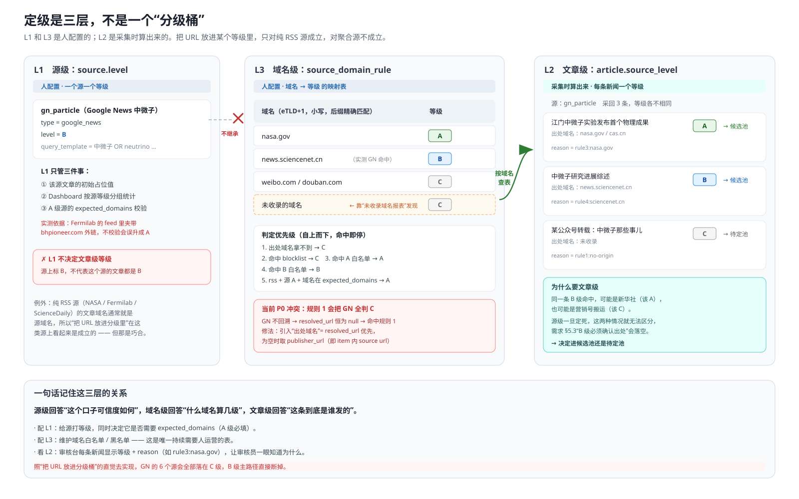
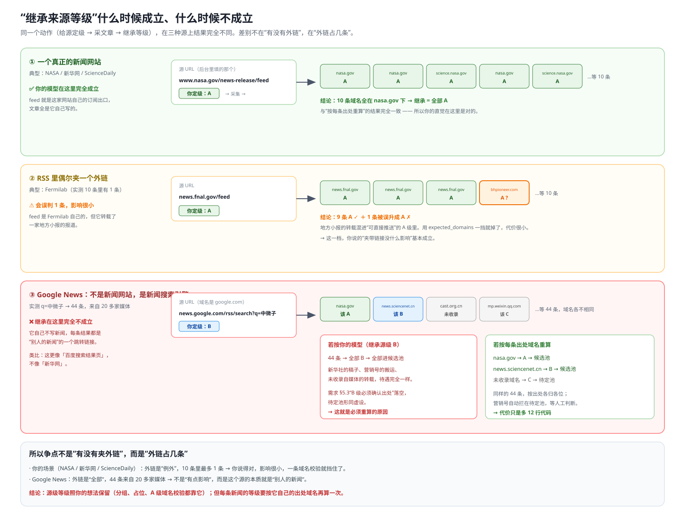
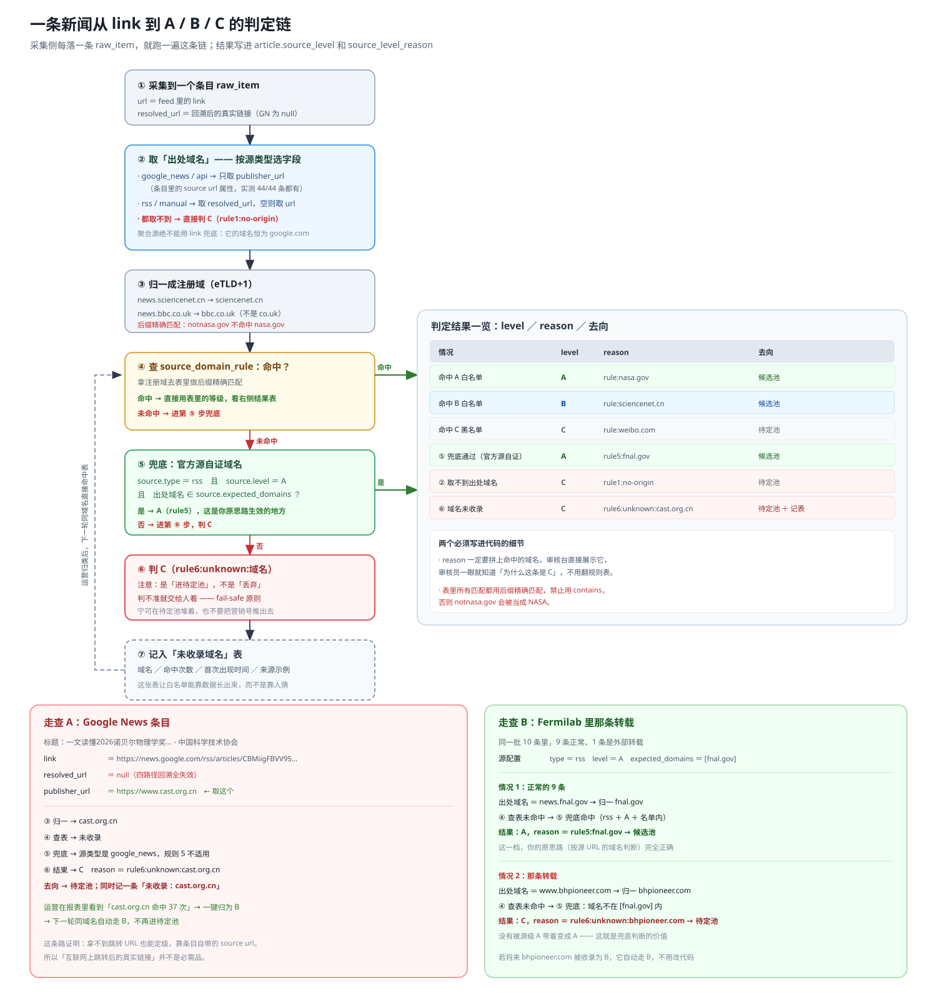
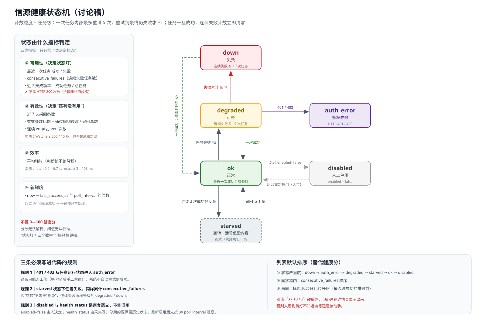

# 03-信源管理

> 版本：v0.2
> 日期：2026-11-26
> 范围：信源的声明、分级、配置、生命周期与可信度规则；不涉及具体拉取动作
> 上游：[01-总体架构.md](../总体架构/01-总体架构.md)、[技术栈.md](../总体架构/技术栈.md)
> 下游：[04-采集.md](./04-采集.md)
> 非目标：HTTP 抓取、调度、解析、落库（全部在 04-采集）
> 配套图：[三级定级](./03-三级定级.svg)、[继承还是重算](./03-继承还是重算.svg)、[定级判定链](./03-定级判定链.svg)、[健康状态机](./03-健康状态机.svg)
> 过程材料：[接口与页面讨论稿](../reference/03-接口与页面-讨论稿.md)（已并入本文，留档）

---

## 0. 文档目的与边界

本文回答：**我们打算从哪里采、这些源各是什么性质、可信度怎么定、配置存在哪里、坏了怎么标记、后台怎么操作。**

不回答：怎么发请求、怎么解析、怎么去重、怎么落库。

一句话：**信源管理是采集的"配置源"。采集进程启动后从 `source` 表读出所有声明，按声明去工作，并把运行结果写回同一张表。**

### 0.1 本版（v0.2）相对 v0.1 的变化

| 变化 | 原因 |
|---|---|
| **定级规则改为 6 步判定链，修掉 v0.1 的 P0 缺陷** | v0.1 规则 1 是"`resolved_url` 为空 → C"，而 04-采集 明确 Google News 不回溯、`resolved_url` 恒为 null → 6 个 GN 源的全部文章会被判 C，B 级主路径直接断掉 |
| 分级明确为**三层模型**（L1 源级 / L3 域名规则 / L2 文章级） | 澄清"把 URL 放进某个分级桶"这个直觉只在纯 RSS 源上成立 |
| 新增 `starved`（空转）状态，健康状态 5 态 → 6 态 | 区分"坏了"（`down`）与"没用了"（`starved`），两者处理动作相反 |
| `source` 表 24 → 30 个字段 | 失败原因可见（3 个）、验证时间（1 个）、有效条数比例（1 个）、验收期望状态（1 个） |
| 新增 `unknown_domain` 表 | 白名单覆盖度不能靠人猜，要靠数据长出来 |
| 新增"有效条数比例"指标 | 唯一能发现"能跑但内容跑偏"的指标 |
| 接口 9 → 19 个 | 补齐详情/趋势/采回条目/单源探活/未收录域名/重算 |
| 源清单 18 → 20 条，并标注 6 类正反验证样本 | 验收要求：不能只有成功源，必须能演示失败与降级 |
| 删除语义收紧 | 有历史数据的源只能停用，否则历史新闻来源断链 |
| 新增重算等级任务 | `article.source_level` 是落库值，改规则不重算会导致同一域名新旧数据等级不一致 |

---

## 1. 职责边界

| 信源管理负责 | 信源管理不负责 |
|---|---|
| `source` / `source_domain_rule` / `unknown_domain` 表结构与 CRUD | 发起 HTTP 请求 |
| 信源清单与 seed | 定时调度 |
| 源级等级（A/B/C）声明 | 文章级等级的计算时机 |
| 域名规则表与定级规则**定义** | 定级规则**执行**（在 04-采集） |
| 健康状态的**存储、展示与重置** | 健康状态的**计算**（采集写回） |
| 后台信源配置页、探活、重算入口 | 原始新闻落地 |

注意最后两行：**健康状态的字段归信源管理，数值由采集写。** 这是本文和 04-采集之间最重要的一条分工。

---

## 2. 信源分级：三层模型

### 2.1 为什么是三层

「把源配成某个等级，这个源的文章就是那个等级」——这个直觉**只在纯 RSS 源上成立**，对聚合源会直接失效。所以分级必须拆成三层：



| 层 | 字段 | 谁决定 | 回答什么问题 |
|---|---|---|---|
| **L1 源级** | `source.level` | 人配置 | 这个口子可信度如何 |
| **L3 域名级** | `source_domain_rule.level` | 人配置 | 什么域名算几级 |
| **L2 文章级** | `article.source_level` | 采集时算出来 | 这条到底是谁发的 |

**L2 不继承 L1。** 文章的等级由定级规则（§6）按出处域名重新计算。

### 2.2 L1 源级只管三件事

这条必须钉死，否则会和采集侧打架：

1. **占位与分组**：`source.level` 作为该源文章的初始占位值；Dashboard 按源等级统计采集量与命中率。
2. **A 级源的域名自证**：A 级 RSS 源必须配 `expected_domains`，采集侧用它在 L2 兜底时挡外部引用文章。
3. **seed 默认值**：新建源时对话框预填。

### 2.3 什么时候"继承"看起来成立、什么时候不成立



同一个动作（给源定级 → 采文章 → 继承等级），在三种源上结果完全不同。**差别不在"有没有外链"，而在"外链占几条"**：

| 源类型 | 典型 | 外链占比 | 继承的结果 | 结论 |
|---|---|---|---|---|
| 真新闻网站 | NASA、新华网、ScienceDaily | 0 | 10 条全 A，与逐条重算一致 | ✅ 直觉成立 |
| 偶尔夹外链 | Fermilab（实测 10 条里 1 条 `bhpioneer.com`） | 10% | 9 条 A ✓、1 条误升 A ✗ | ⚠️ 用 `expected_domains` 一挡就掉，代价很小 |
| 新闻搜索引擎 | Google News（实测 q=中微子 → 44 条来自 20 多家媒体） | 100% | 44 条全 B，营销号与新华社待遇相同 | ❌ 继承完全不成立 |

**结论**：L1 源级按原思路保留（分组、占位、A 级域名校验都靠它）；但每条新闻的等级必须按它自己的出处域名再算一次。**代价只是多十几行代码。**

### 2.4 为什么文章级不可省

Google News 的一条 B 级命中可能指向 `nasa.gov`（该 A）、`news.sciencenet.cn`（该 B），也可能指向某个营销号（该 C）。

源级一旦定死，这三种情况就无法区分，需求 §5.3「B 级必须回溯确认出处」会落空，待定池形同虚设。

---

## 3. `source` 数据模型

### 3.1 字段总表（30 个）

| # | 字段 | 类型 | 读写 | 说明 |
|---|---|---|---|---|
| 1 | `id` | int PK | 系统 | |
| 2 | `code` | str UNIQUE | **人** | 稳定机器名，如 `nasa_breaking`；seed 幂等键 |
| 3 | `name` | str | **人** | 后台展示名 |
| 4 | `type` | enum | **人** | `rss` / `google_news` / `api` / `manual` |
| 5 | `level` | enum | **人** | `A` / `B` / `C`，**源级**等级 |
| 6 | `url` | str | **人** | Feed 或 API 地址 |
| 7 | `query_template` | str NULL | **人** | 仅 `google_news`，见 04-采集 §4.3 |
| 8 | `poll_interval_min` | int | **人** | 轮询间隔（分钟） |
| 9 | `enabled` | bool | **人** | 启停 |
| 10 | `expected_domains` | JSONB | **人** | A 级源必填，允许域名列表 |
| 11 | `title_suffix_rules` | JSONB | **人** | 标题去后缀规则 |
| 12 | `extra_headers` | JSONB | **人** | 源特有请求头 |
| 13 | `api_key_env` | str NULL | **人** | API 源从哪个**环境变量名**读 key（不存 key 本身） |
| 14 | `note` | text | **人** | 备注，如"需求文档点名源""演示样本：地址变迁" |
| 15 | `etag` | str NULL | Worker | 条件请求用 |
| 16 | `last_modified` | str NULL | Worker | 条件请求用 |
| 17 | `last_poll_at` | datetime NULL | Worker | 上次轮询时间 |
| 18 | `last_success_at` | datetime NULL | Worker | 上次成功时间 |
| 19 | `consecutive_failures` | int | Worker | 连续失败**任务数**（见 §7.4） |
| 20 | `success_count` | int | Worker | 累计成功任务数 |
| 21 | `error_count` | int | Worker | 累计失败任务数 |
| 22 | `health_status` | enum | Worker | 6 态，见 §7.1 |
| 23 | `last_error` | text NULL | Worker | **新增**，错误原文（截断 2000 字） |
| 24 | `last_error_at` | datetime NULL | Worker | **新增** |
| 25 | `last_error_kind` | enum NULL | Worker | **新增**，6 种，见 §7.5 |
| 26 | `last_validated_at` | datetime NULL | 人（触发探活时写） | **新增**，支撑"从未验证"提示 |
| 27 | `effective_ratio_7d` | float NULL | AI 层 | **新增**，有效条数比例；本模块只读 |
| 28 | `expected_status_on_first_run` | enum NULL | seed | **新增**，仅 `--verify` 对账用，见 §10.3 |
| 29 | `created_at` | datetime | 系统 | |
| 30 | `updated_at` | datetime | 系统 | |

### 3.2 读写权限（硬约束）

- **后台（API）只能写**：`code`、`name`、`type`、`level`、`url`、`query_template`、`poll_interval_min`、`enabled`、`expected_domains`、`title_suffix_rules`、`extra_headers`、`api_key_env`、`note`、`last_validated_at`。
- **Worker 只能写**：`etag`、`last_modified`、`last_poll_at`、`last_success_at`、`consecutive_failures`、`success_count`、`error_count`、`health_status`、`last_error`、`last_error_at`、`last_error_kind`。
- **AI 层只能写**：`effective_ratio_7d`。

**为什么必须严格分**：如果后台保存时把整个对象写回，人改一次配置就会把「连续失败 9 次」冲成 0，故障被静默抹掉。API 收到运行态字段必须显式报 `400 READONLY_FIELD`，不做静默忽略。

---

## 4. 信源类型

| type | 用途 | 必填专属字段 | 采集侧适配器 | 出处域名取法（§6 第 2 步） |
|---|---|---|---|---|
| `rss` | 标准 RSS / Atom | `url`；A 级还需 `expected_domains` | `RssAdapter` | `resolved_url`，空则 `url` |
| `google_news` | Google News 关键词监控 | `url` 或 `query_template` | `GoogleNewsAdapter` | **只取 `publisher_url`** |
| `api` | 第三方聚合 API | `url`、`api_key_env` | `ApiAdapter` | **只取 `publisher_url`** |
| `manual` | 手工导入入口 | 无 | 无（走导入接口） | `url` |

`manual` 类型的用途是给 C 级线索和演示兜底留落点：手工导入的条目也要挂在某个 source 下，否则 `raw_item.source_id` 没有归属。**建议 seed 一条 `code='manual'`、`level='C'` 的内置源，且不允许删除。**

> **聚合源（`google_news` / `api`）绝不能用 `url` 兜底取域名**——它们的域名恒为 `google.com` / 聚合站域名，会把所有文章判成同一级。

---

## 5. 信源清单（20 条）

### 5.1 清单总表

> 可达性结论来自 [05-采集数据测试.md](./05-采集数据测试.md)（2026-11-25 实测 19 个 URL）。`expected_status_on_first_run` 仅用于 `seed --verify` 对账，不参与运行逻辑。

| # | code | name | type | level | URL / query | 轮询 | enabled | 期望首跑状态 | 说明 |
|---|---|---|---|---|---|---|---|---|---|
| 1 | `nasa_breaking` | NASA Breaking News | rss | A | `https://www.nasa.gov/news-release/feed/` | 30 | ✅ | `ok` | 需求点名源；200 / 10 条 |
| 2 | `esa_news` | ESA News | rss | A | `https://www.esa.int/ESA/Feeds/News` | 30 | ❌ | `down` | 需求点名源；**2026-11-26 实测 HTTP 404**（更早一次为连接中断），地址已失效，保留配置待确认新地址 |
| 3 | `fnal_news` | Fermilab Newsroom | rss | A | `https://news.fnal.gov/feed/` | 30 | ✅ | `ok` | 需求点名源；200 / 10 条；**10 条里有 1 条外链 `bhpioneer.com`** |
| 4 | `atel` | Astronomer's Telegram | rss | A | `https://www.astronomerstelegram.org/rss` | 15 | ❌ | `auth_error` | 需求点名源；**403（浏览器 UA 也 403）**，需 token |
| 5 | `phys_space` | phys.org Space | rss | A | `https://phys.org/rss-feed/space-news/` | 30 | ✅ | `ok` | 200 / 30 条；**文章页 403**，正文走摘要回退 |
| 6 | `phys_neuro` | phys.org Neuroscience | rss | A | `https://phys.org/rss-feed/science-news/neuroscience/` | 30 | ✅ | `ok` | 原地址 404，**已换新地址**；200 / 30 条 |
| 7 | `sd_bci` | ScienceDaily Brain & Behavior | rss | A | `https://www.sciencedaily.com/rss/mind_brain.xml` | 30 | ✅ | `ok` | 需求点名源；**子类 feed 已删除**，退到分类级；200 / 60 条 |
| 8 | `sd_astronomy` | ScienceDaily Astronomy | rss | A | `https://www.sciencedaily.com/rss/space_time/astronomy.xml` | 30 | ✅ | `ok` | 200 / 60 条 |
| 9 | `sd_space` | ScienceDaily Space & Time | rss | A | `https://www.sciencedaily.com/rss/space_time.xml` | 30 | ✅ | `ok` | 200 / 60 条 |
| 10 | `watchers_neo` | The Watchers | rss | B | `https://watchers.news/feed/` | 30 | ✅ | `ok` | 需求点名源；200 / 10 条，但**内容是全球地震火山，与近地天体无关**（见 §5.4 S6） |
| 11 | `gn_particle` | GN 中微子/暗物质 | google_news | B | query Q1 | 60 | ✅ | `ok` | 实测 44 条（Q1 原为 12 条，随关键词调整变化） |
| 12 | `gn_asteroid` | GN 小行星/飞掠 | google_news | B | query Q2 | 60 | ✅ | `ok` | 实测 16 条 |
| 13 | `gn_exoplanet` | GN 类地/系外行星 | google_news | B | query Q3 | 60 | ✅ | `ok` | 实测 5 条，量偏少 |
| 14 | `gn_bci` | GN 脑机/意念 | google_news | B | query Q4 | 60 | ✅ | `ok` | 实测 65 条，量大噪声中等 |
| 15 | `gn_paranormal` | GN 灵异/通灵/道士 | google_news | B | query Q5 | 60 | ✅ | `ok` | **基本失效**：`通灵` 命中上市公司「通灵股份 301168」，`超自然` 命中游戏。见 §5.4 S6 |
| 16 | `gn_ufo` | GN UFO/UAP | google_news | B | query Q6 | 60 | ✅ | `ok` | 实测 18 条 |
| 17 | `tianapi_science` | 天聚数行 科学探索 | api | B | `https://apis.tianapi.com/science/index` | 120 | ❌ | `auth_error` | 需求点名源；**404 且需 key**（`TIANAPI_KEY`） |
| 18 | `manual` | 手工导入 | manual | C | — | — | ✅ | `ok` | **内置源，不可删除**；C 级线索与演示兜底 |
| 19 | `phys_neuro_legacy` | phys.org Neuroscience（旧地址） | rss | A | `https://phys.org/rss-feed/neuroscience-news/` | 30 | ❌ | `down` | **演示样本 S4**：地址变迁，故意保留 404 旧地址 |
| 20 | `esa_backup_html` | ESA 备用（HTML 页） | rss | A | `https://www.esa.int/Enabling_Support/Operations` | 30 | ❌ | `down` | **演示样本 S5**：返回 200 但内容不是 feed（实测 `bozo=1`、0 条）→ 按 04 §13.1 归 `parse`。见 §5.5 |

### 5.2 缺口修正记录

v0.1 的清单有 3 处与实测不符，本版已改：

| v0.1 | 实测 | 本版处理 |
|---|---|---|
| `phys_neuro` = `phys.org/rss-feed/neuroscience-news/` | 404 | 换成 `phys.org/rss-feed/science-news/neuroscience/`（200/30）；旧地址保留为演示样本 `phys_neuro_legacy` |
| `sd_bci` = ScienceDaily `brain_computer_interfaces` 子类 | 404，子类 feed 已删 | 退到分类级 `mind_brain.xml`（200/60）；代价是全类内容，靠下游 `is_event` 筛，属**召回冗余**，符合"宁可多采"原则 |
| `watchers_neo` 标为"近地天体源" | 内容实为全球灾害站 | 等级降为 B，并加 `note` 说明；作为 S6 样本保留 |

### 5.3 覆盖度自查

| 内容类别 | A 级源 | B 级源 | 结论 |
|---|---|---|---|
| 深空 / 粒子 | Fermilab、phys.org Space | GN 中微子 | 覆盖充足 |
| 近地天体 | ScienceDaily Space | GN 小行星、The Watchers | 覆盖充足（Watchers 内容跑偏，靠 GN 补） |
| 新星球 / 类地行星 | ScienceDaily、phys.org | GN 系外行星 | 覆盖充足 |
| 脑机 / 意识 | phys.org Neuroscience、ScienceDaily Mind & Brain | GN 脑机 | 覆盖充足 |
| 异常 / 灵能 | **没有** | GN 灵异、GN UFO | **结构性缺口**，见下 |

**"异常/灵能"没有 A 级源，这是内容的客观属性，不是配置疏漏。** 这类内容在天文/科研机构源里本就不存在，只能靠关键词监控 + 人工导入，天然落在 B/C 级，进待定池是设计结果。

### 5.4 六类正反验证样本（验收要求）

源清单不能只放成功源，否则演示时无法证明系统"能识别故障"。20 条源覆盖 6 类情形，每类的处理动作不同：

| 样本 | 故障实质 | 源 | 期望状态 | 演示动作 |
|---|---|---|---|---|
| **S1 正常** | — | `nasa_breaking`、`fnal_news`、`phys_space`、`sd_*`、`gn_*` | `ok` | 无动作，作为对照基准 |
| **S2 鉴权失败** | 需凭据 | `atel`（403）、`tianapi_science`（无 key → 401/404） | `auth_error` | 点探活看 `suggestion` → 配 key → 重置健康度 |
| **S3 网络波动** | 握手层抖动 | `esa_news`；任意源偶发 TLS 抖动 | `degraded` → 自动回 `ok` | 看运行记录里 `attempts > 1` 但最终成功，说明重试生效，**无需人工介入** |
| **S4 地址/结构变迁** | 源搬家 | `phys_neuro_legacy`（404） | `down` | 编辑 URL 为新地址 → 探活 → 保存 → 状态恢复 `ok` |
| **S5 不是 feed** | 200 但内容不是 feed | `esa_backup_html`（200、`bozo=1`、0 条） | `down` | 看"`parse` 解析失败"与"连接失败"分开显示 → 换地址或下线 |
| **S6 内容跑偏** | 有条目但与选题无关 | `watchers_neo`（地震新闻）、`gn_paranormal`（股票新闻、游戏） | `ok`，但**有效条数比例极低** | 看有效条数比例 + 详情页"采回条目"Tab 的判定结果 → 换 query 或下线 |

**S4 / S5 必须"故意保留坏配置"**：正确地址我们已经知道（`phys_neuro` → `science-news/neuroscience/`），如果直接配对的地址，就演示不出"变迁"。所以 `phys_neuro_legacy` 与 `esa_backup_html` 默认 `enabled=false`，演示时手动启用跑一次。

> **S6 的诚实说明**：`starved` 抓不到它。`starved` 的条件是"连续 3 次成功但 **0 条**"，而 `watchers_neo` 有 10 条——系统在信源层无法判断"这几条地震新闻算不算近地天体"，那需要 AI 层的 `is_event` + 五类判定。所以 S6 只能靠**有效条数比例**与**采回条目的判定结果**由人发现，不能靠状态灯自动识别。这是有意的模块边界，不是缺陷。

### 5.5 S5 的实际判定：不是 `starved`，是 `parse`

v0.2 原写「200 但 0 条 → `starved`」。**实测推翻了这个假设**：

| 情形 | feedparser | 条目 | `error_kind` | 状态走向 |
|---|---|---|---|---|
| HTML 页面（`esa_backup_html` 实测） | `bozo=1` | 0 | `parse` | 任务失败 → 累计失败 → `down` |
| 合法 feed 但没有 item | `bozo=0` | 0 | `empty_feed` | 任务**成功** → 连续 3 次 → `starved` |

`starved` 的定义是「**成功**跑通但连续 3 次 0 条」（§7.1），它抓不到"返回的根本不是 feed"这种情况。两者处理动作也不同：`parse` 要去检查地址是否搬家，`starved` 要评估这个源还有没有价值。

所以：`esa_backup_html` 的期望状态改为 `down`；`starved` 的代码路径由 `backend/tests/fixtures/feeds/empty.xml`（合法空 feed）在单测里覆盖。

---

## 6. 来源定级规则

声明在本文，**执行在 04-采集**。每落一条 `raw_item` 就跑一遍这条链。



### 6.1 六步判定链

| 步 | 动作 | 失败/未命中如何走 |
|---|---|---|
| ① | 采集到一个条目 `raw_item`。`url` = feed 里的 `link`；`resolved_url` = 回溯后的真实链接（GN 为 `null`） | — |
| ② | **取出处域名**（按源类型选字段，见 §4） | 两个字段都取不到 → **判 C**，`reason=rule1:no-origin` |
| ③ | 归一成注册域（eTLD+1，小写） | 归一失败（如非法域名）→ 判 C，`reason=rule1:no-origin` |
| ④ | 查 `source_domain_rule`，命中即用表里的等级 | 未命中 → 进入第 ⑤ 步 |
| ⑤ | 兜底：官方源自证 —— `type='rss'` 且 `source.level='A'` 且出处域名 ∈ `expected_domains` → **A**，`reason=rule5:<domain>` | 不满足 → 进入第 ⑥ 步 |
| ⑥ | **判 C**，`reason=rule6:unknown:<domain>`；同时记入 `unknown_domain` 表 | — |

### 6.2 规则编号与 reason 格式

| 编号 | 条件 | 结果 | reason 示例 | 去向 |
|---|---|---|---|---|
| `rule1` | 取不到出处域名 | C | `rule1:no-origin` | 待定池 |
| `rule2` | 命中规则且等级 = A | A | `rule2:nasa.gov` | 候选池 |
| `rule3` | 命中规则且等级 = B | B | `rule3:sciencenet.cn` | 候选池 |
| `rule4` | 命中规则且等级 = C | C | `rule4:weibo.com` | 待定池 |
| `rule5` | rss + 源 A + 域名 ∈ `expected_domains` | A | `rule5:fnal.gov` | 候选池 |
| `rule6` | 域名未收录 | C | `rule6:unknown:cast.org.cn` | 待定池 + 记表 |

**两条必须写进代码的细节**：

1. **`reason` 必须拼上命中的域名**。审核台直接展示它，审核员一眼就知道"为什么这条是 C"，不用翻规则表。
2. **所有匹配都用后缀精确匹配，禁止用 `contains` / `LIKE '%...%'`**，否则 `notnasa.gov` 会被当成 NASA。

### 6.3 fail-safe 原则

**判不准就交给人看。** 宁可在待定池堆着，也不要把营销号推出去。

所以 C 不是"丢弃"，而是"进待定池等人工"。规则 1 与规则 6 都落在 C，是有意的保守设计。

### 6.4 `source_domain_rule` 表

| 字段 | 类型 | 说明 |
|---|---|---|
| `id` | int PK | |
| `domain` | str UNIQUE | 注册域（eTLD+1），不含 `www.`，小写 |
| `level` | enum | `A` / `B` / `C`（C 即 blocklist） |
| `note` | text NULL | 备注，审核详情页会展示 |
| `enabled` | bool | 软删除用 |
| `created_at` / `updated_at` | datetime | |

### 6.5 初版域名 seed

> 带 ★ 的是**实测 Google News 真实命中**的域名。v0.1 漏了它们，会导致 GN 源全部落在 C。

- **A 级**：`nasa.gov`、`esa.int`、`fnal.gov`、`astronomerstelegram.org`、`sciencedaily.com`、`phys.org`、`xinhuanet.com`、`cctv.com`、`cas.cn`★、`cast.org.cn`★
- **B 级**：`bbc.com`、`bbc.co.uk`、`reuters.com`、`apnews.com`、`theguardian.com`、`nature.com`、`science.org`、`space.com`、`sciencenet.cn`★
- **C 级**：`weibo.com`、`douban.com`、`bilibili.com`、`zhihu.com`、`mp.weixin.qq.com`

> 这张表不可能一次穷举。**它的覆盖度靠 `unknown_domain` 报表长出来**（§6.6），而不是靠人猜。

### 6.6 `unknown_domain` 表（未收录域名）

| 字段 | 类型 | 说明 |
|---|---|---|
| `id` | int PK | |
| `domain` | str UNIQUE | 未收录的注册域 |
| `hit_count` | int | 累计命中次数 |
| `first_seen_at` | datetime | |
| `last_seen_at` | datetime | |
| `sample_title` | str NULL | 命中示例标题 |
| `sample_source_code` | str NULL | 从哪个源采到的 |

**写入**：采集侧在规则 6 触发时 upsert（`hit_count + 1`、更新 `last_seen_at` 与样本）。
**消费**：`GET /api/source-domain-rules/unknown` 按命中次数排序展示；运营一键归为 A/B/C（调 `POST /api/source-domain-rules`，**同事务内删除该未收录记录**）；下一轮同域名直接命中规则表，不再进待定池。

### 6.7 域名归一

| 输入 | 输出 | 说明 |
|---|---|---|
| `news.bbc.co.uk` | `bbc.co.uk` | eTLD+1，**不是 `co.uk`** |
| `www.nasa.gov` | `nasa.gov` | 去掉 `www.` |
| `NEWS.Sciencenet.CN` | `sciencenet.cn` | 统一小写 |
| `notnasa.gov` | `notnasa.gov` | 不会被 `nasa.gov` 命中（后缀精确匹配） |

### 6.8 定级结果写在哪

由采集写回 `article`：

| 字段 | 内容 |
|---|---|
| `article.source_level` | 最终等级 |
| `article.source_level_reason` | 规则编号 + 命中域名，如 `rule3:sciencenet.cn` |
| `article.publisher_name` | 出处媒体名（GN 取 `<source>` 文本） |
| `article.publisher_url` | 出处 URL（GN 取 `<source url>`，实测 44/44 条都有） |

### 6.9 两个走查

**走查 A：Google News 条目**

| 项 | 值 |
|---|---|
| 标题 | 一文读懂 2026 诺贝尔物理学奖… - 中国科学技术协会 |
| `link` | `https://news.google.com/rss/articles/CBMiigFBVV95…` |
| `resolved_url` | `null`（四条回溯路径全失效） |
| `publisher_url` | `https://www.cast.org.cn` ← **取这个** |
| ③ 归一 | `cast.org.cn` |
| ④ 查表 | 未收录 |
| ⑤ 兜底 | 源类型是 `google_news`，规则 5 不适用 |
| ⑥ 结果 | **C**，`reason=rule6:unknown:cast.org.cn`，去向待定池，同时记一条未收录 |

运营在报表里看到「`cast.org.cn` 命中 37 次」→ 一键归为 A → 下一轮同域名自动走 A。
**这条路证明：拿不到跳转后的真实 URL 也能定级，靠条目自带的 `source url` 即可。所以"互联网上跳转后的真实链接"不是必需品。**

**走查 B：Fermilab 里那条转载**

源配置：`type=rss`、`level=A`、`expected_domains=[fnal.gov]`。同批 10 条里 9 条正常、1 条外部转载。

| 情况 | 出处域名 | ④ 查表 | ⑤ 兜底 | 结果 |
|---|---|---|---|---|
| 正常 9 条 | `news.fnal.gov` → `fnal.gov` | 未命中 | 命中（rss + A + 名单内） | **A**，`rule5:fnal.gov` → 候选池 |
| 转载 1 条 | `www.bhpioneer.com` → `bhpioneer.com` | 未命中 | 不命中（不在 `[fnal.gov]`） | **C**，`rule6:unknown:bhpioneer.com` → 待定池 |

**没有被源级 A 带着变成 A —— 这就是兜底判断的价值。** 若将来 `bhpioneer.com` 被收录为 B，它自动走 B，不用改代码。

---

## 7. 健康状态与生命周期



### 7.1 六态取值

| 状态 | 中文 | 进入条件 | 退出条件 | 人该做什么 |
|---|---|---|---|---|
| `down` | 失效 | `consecutive_failures ≥ 10` | 一次成功即回 `ok` | 换地址或停用 |
| `auth_error` | 鉴权失败 | HTTP 401 / 403 | 改 key 后**手工重置** | 配 key |
| `degraded` | 可疑 | `consecutive_failures ≥ 3`（3—9） | 一次成功即回 `ok` | 观察，多为网络抖动 |
| `starved` | 空转 | 连续 3 次成功但 **0 条** | 采回 ≥1 条 | 评估是否还有价值 |
| `ok` | 正常 | 最近一次成功且有条目 | — | — |
| `disabled` | 已停用 | 后台 `enabled=false` | 后台重新启用 | — |

> **阈值硬编码**（3 / 10 / 3），不做配置页；但必须在详情页把阈值显示出来，否则人看到黄灯不知道该等还是该动手。

### 7.2 四类指标，只有第一类决定状态灯

| 类别 | 指标 | 回答什么 |
|---|---|---|
| **① 可用性**（决定状态灯） | 最近一次任务成功/失败、`consecutive_failures`、近 7 天成功率 | 现在能不能用 |
| **② 有效性** | 近 7 天采回条数、**有效条数比例**（通过规则过滤且 `is_event=true` 的占比）、连续 `empty_feed` 次数 | **还有没有用** |
| **③ 效率** | 平均耗时、P95 耗时 | 该不该降频 |
| **④ 新鲜度** | `now - last_success_at` 与 `poll_interval_min` 的倍数 | 是不是"看着 ok 其实早不跑了" |

**①② 必须分开**，这是本项目最容易出错的地方。`watchers_neo` 实测 HTTP 200 / 10 条，**但全是地震与火山新闻**——可用性 100%，有效性 0%。只看可用性，这个源永远是绿灯。

**近 7 天成功率的口径**：成功**任务数** / 总任务数，**不是 HTTP 200 次数**。引入 tenacity 重试后，一次任务内部可能有 5 次请求，用请求数算成功率会虚高。

### 7.3 计数粒度：任务级（硬约束）

`consecutive_failures` **按"任务级"计数**：

- 一次任务内部最多重试 5 次（见 [技术栈.md](../总体架构/技术栈.md) §5.5）
- **重试到最终仍失败，才 +1**
- 任务一旦成功，`consecutive_failures` 立即清零

如果按"HTTP 请求级"计数，一次任务失败会被记 5 次，`degraded ≥ 3` 在一次任务内就触发，阈值形同虚设。

### 7.4 谁改，以及"重置"的确切语义

- **采集侧**每个任务结束时更新 `consecutive_failures`、`success_count`、`error_count`、`health_status`、`last_error*`。
- **后台不能直接改** `health_status` 的数值，只能点"重置健康度"：
  - 清 `consecutive_failures` → 0
  - 清 `last_error`、`last_error_at`、`last_error_kind`
  - `health_status` → `ok`
  - **保留** `success_count` / `error_count`（累计值不清，否则成功率历史被抹掉）
  - 写 `review_action`
- `enabled=false` 时采集侧必须跳过该源。**它不等同于 `health_status='disabled'` 的自动判定，两者不能混用**：`enabled` 由人决定，`health_status` 由采集写。

### 7.5 `last_error_kind` 六种取值

| 值 | 触发 | 典型 `suggestion` |
|---|---|---|
| `connect` | 连接失败 / 超时 / TLS 握手失败 | "网络层不可达，稍后重试；持续失败请检查地址或换机复测" |
| `http_4xx` | 400 / 404 / 410 等 | "返回 404，源地址可能已迁移，请确认新地址" |
| `http_5xx` | 500 / 502 / 503 | "服务端错误，稍后重试" |
| `auth` | 401 / 403 | "需要凭据。请配置 `api_key_env` 后重置健康度" |
| `parse` | feedparser `bozo=1` 且无条目 | "返回内容不是合法 feed，请确认地址" |
| `empty_feed` | 200 且解析成功但 0 条 | "返回 0 条。feed 可能是空壳页，或该源近期确实无更新" |

**`empty_feed` 与 `error` 必须分开显示**，否则人会对告警麻木——前者可能是"源正常，确实没新闻"，后者是明确故障。

### 7.6 列表默认排序（替代健康分）

**不做 0—100 的健康分**：分数无法解释、阈值无从校准。改用三级排序，完全可解释：

1. **状态严重度**：`down` → `auth_error` → `degraded` → `starved` → `ok` → `disabled`
2. **同状态**：`consecutive_failures` 降序
3. **再同**：`last_success_at` 升序（最久没成功的排最前）

### 7.7 三条必须写进代码的规则

1. **401/403 从任意运行状态进入 `auth_error`**，且只能人工修（换 key 后手工重置），系统不自动重试到成功。
2. **`starved` 状态下任务失败，同样累计 `consecutive_failures`** —— "空转"不等于"豁免"，连续失败照样升级到 `degraded` / `down`。
3. **重新启用时状态置 `degraded`，不直接置 `ok`** —— 停用期间源可能已经坏了，直接绿灯会误导。首次任务成功才转 `ok`。

---

## 8. 接口（19 个端点 / 5 组）

### 8.1 通用约定

| 项 | 约定 |
|---|---|
| 前缀 | `/api`；OpenAPI 在 `/docs`，机器可读 `/openapi.json` |
| 认证 | 单管理员 JWT（`HttpOnly` Cookie）；所有写操作校验"已登录"并写 `review_action` |
| 分页 | 请求 `page`（默认 1）、`page_size`（默认 20，上限 100）；响应 `items` / `total` / `page` / `page_size` |
| 时间 | ISO 8601 UTC；前端按 `Asia/Shanghai` 展示 |
| 错误 | `{ "code": "...", "message": "...", "detail": {...} }` |
| 类型 | 所有响应必须是明确 Pydantic model，保证 `openapi-typescript` 能生成类型 |

### 8.2 端点总表

| 编号 | 方法 | 路径 | 作用 |
|---|---|---|---|
| **组 1：查询** | | | |
| S1 | GET | `/api/sources` | 列表 + 筛选 + 排序 + 分页 |
| S2 | GET | `/api/sources/summary` | 顶部 KPI |
| S3 | GET | `/api/sources/{id}` | 详情（含统计与阈值） |
| S4 | GET | `/api/sources/{id}/runs` | 最近 N 次运行记录 |
| S5 | GET | `/api/sources/{id}/items` | 最新 N 条采回条目 + 判定结果 |
| **组 2：配置** | | | |
| S6 | POST | `/api/sources` | 新建 |
| S7 | PATCH | `/api/sources/{id}` | 改配置字段 |
| S8 | POST | `/api/sources/{id}/toggle` | 启停 |
| S9 | DELETE | `/api/sources/{id}` | 删除（受 §8.4 约束） |
| **组 3：动作** | | | |
| S10 | POST | `/api/sources/{id}/poll` | 立即采集一次（异步） |
| S11 | POST | `/api/sources/{id}/reset-health` | 重置健康度 |
| V1 | POST | `/api/sources/validate` | 全量探活 |
| V2 | POST | `/api/sources/validate-one` | 单源 / 未保存配置探活 |
| **组 4：域名规则** | | | |
| R1 | GET | `/api/source-domain-rules` | 规则列表 |
| R2 | POST | `/api/source-domain-rules` | 新增规则（自动清未收录记录） |
| R3 | PATCH | `/api/source-domain-rules/{id}` | 改等级 / 备注 / 启停 |
| R4 | GET | `/api/source-domain-rules/unknown` | 未收录域名报表 |
| R5 | DELETE | `/api/source-domain-rules/{id}` | 软删除 |
| **组 5：重算** | | | |
| C1 | POST | `/api/sources/recalc-levels` | 重算历史文章等级（异步） |

### 8.3 主要 DTO

**`SourceListItem`（S1）**

`id`、`code`、`name`、`type`、`level`、`poll_interval_min`、`enabled`、`health_status`、`consecutive_failures`、`last_poll_at`、`last_success_at`、`last_validated_at`、`success_rate_7d`、`avg_duration_ms_7d`、`items_7d`、`effective_ratio_7d`、`last_error_kind`、`last_error`

**`SourceDetail`（S3）** = §3.1 的 30 个存储字段 + 4 个派生字段

| 派生字段 | 说明 |
|---|---|
| `key_configured` | `api_key_env` 指向的环境变量是否已设值（**不返回 key 本身**） |
| `etag_cached` | `etag` 或 `last_modified` 是否有值 |
| `stats` | 见下 |
| `thresholds` | `{ "degraded": 3, "down": 10, "starved": 3 }`，前端直接显示，不在前端硬编码 |

**`SourceStats`（嵌在 S3）**

`success_rate_7d`、`items_7d`、`effective_ratio_7d`、`empty_runs_7d`、`avg_duration_ms_7d`、`p95_duration_ms_7d`、`last_run_at`

**`RunItem`（S4）**

`id`、`started_at`、`finished_at`、`status`（`pending`/`running`/`success`/`failed`）、`fetched`、`duration_ms`、**`attempts`（实际 HTTP 尝试次数，用于展示重试是否生效）**、`error_kind`、`error`

**`CollectedItem`（S5）** —— S6 内容跑偏的判定依据

`raw_item_id`、`raw_title`、`fetched_at`、`article_id`、`source_level`、`source_level_reason`、`is_event`、`event_type`、`status`、`reject_reason`

**`ValidateResult`（V1 / V2）**

`source_id`、`code`、`ok`（200 且条目 > 0）、`http_status`、`entries`、`duration_ms`、`error_kind`、`error`、**`suggestion`（给管理员看的动作建议）**、`preview`（前 3 条 `{title, published, link}`）

**`DomainRule` / `UnknownDomain`**

- `DomainRule`：`id`、`domain`、`level`、`note`、`enabled`、`hit_count_30d`（派生）
- `UnknownDomain`：`domain`、`hit_count`、`first_seen_at`、`last_seen_at`、`sample_title`、`sample_source_code`

### 8.4 关键行为（实现时必须照做）

**S1 默认排序**：见 §7.6。`sort_by` 只允许 `code` / `level` / `last_success_at` / `success_rate_7d` / `items_7d`，其余回落默认排序，**避免任意列名进入 SQL**。

**S6 新建：探活不是前置条件**

- 无论是否验证过都返回 `201`；未验证则带 `warning`：`{ "code": "NOT_VALIDATED", "message": "该源尚未验证过，可能不可用。建议先点探活确认。" }`
- 此时 `last_validated_at` 保持 `null`，列表显示"从未验证"标签

**S7 改配置**：传运行态字段 → `400 READONLY_FIELD`，`detail.rejected_fields` 列出字段名。**不做静默忽略**，否则前端以为改成功了。A 级源 `expected_domains` 为空 → `400 MISSING_EXPECTED_DOMAINS`。

**S8 启停**：停用时 `health_status → disabled` 但**保留 `consecutive_failures`**；重新启用时置 `degraded`（见 §7.7 第 3 条）。

**S9 删除**（三重约束）

| 情况 | 结果 |
|---|---|
| 有 `raw_item` | `409 SOURCE_HAS_DATA`，`detail.raw_item_count` + 建议"请改用停用" |
| `code='manual'` | `409 BUILTIN_SOURCE` |
| 无数据且非内置 | `204` |

**S10 立即采集**：只插 `task_run(task_type='poll', status='pending')`，**API 进程绝不发 HTTP 请求**，返回 `{ task_run_id, status: "pending" }`，前端轮询 S4 看结果。

**S11 重置健康度**：语义见 §7.4（清 `consecutive_failures` 与 `last_error*`，保留累计计数）。

**V1 全量探活：同步接口，参数必须独立于采集**

| 参数 | 采集模式 | 探活模式 | 理由 |
|---|---|---|---|
| 超时 | 25 s | **8 s** | 探活要"能不能通"，不是"一定拿到" |
| 重试 | 5 次退避 | **1 次** | 20 源 × 5 次 × 8 s 最坏 800 s，人不可能等 |
| 并发 | 4 | 4 | 最坏约 `20/4 × 8 = 40 s` |
| 副作用 | 写 `raw_item` | **不写业务数据**，只写 `last_validated_at` | 探活是只读检查 |

**V2 单源探活**：请求体收**配置而非 id**（支持"新建时还没保存"场景），不写库；仅当传了 `source_id` 时更新该源 `last_validated_at`。

**R2 新增规则**：域名归一 → 查重（`409 DOMAIN_EXISTS`）→ 建规则 → **同事务删除 `unknown_domain` 中同域名记录** → 返回 `recalc_suggested: true`。

**C1 重算等级**

| 项 | 约定 |
|---|---|
| 为什么必须有 | `article.source_level` 是落库值，改规则不重算会导致同一域名新旧数据等级不一致 |
| 并发 | 同时只允许 1 个任务，已有在跑 → `409 RECALC_IN_PROGRESS` |
| 范围 | 默认只重算**未发布**文章；`published` / `unpublished` 不追溯，避免改已上线内容 |
| 统计 | `task_run.stats_json` = `{scanned, changed, skipped_published}` |
| 版本 | 用**当前**规则表，不做规则版本化（MVP） |

### 8.5 错误码

| `code` | HTTP | 场景 |
|---|---|---|
| `SOURCE_NOT_FOUND` | 404 | id 不存在 |
| `SOURCE_CODE_DUPLICATE` | 409 | `code` 已存在 |
| `SOURCE_HAS_DATA` | 409 | 删除时仍有 `raw_item` |
| `BUILTIN_SOURCE` | 409 | 试图删 `code='manual'` |
| `READONLY_FIELD` | 400 | PATCH 传了运行态字段 |
| `MISSING_EXPECTED_DOMAINS` | 400 | A 级源缺 `expected_domains` |
| `INVALID_TYPE_FIELD` | 400 | `rss` 却传了 `query_template` |
| `DOMAIN_EXISTS` | 409 | 域名规则重复 |
| `INVALID_DOMAIN` | 400 | 归一后不是合法 eTLD+1 |
| `RECALC_IN_PROGRESS` | 409 | 已有重算在跑 |

> 探活"源不可用"**不算接口错误**：接口照常 `200`，结果放在 `results[].ok=false`。

---

## 9. 后台页面（2 页 + 2 抽屉 + 3 Modal）

> 前端统一用 Ant Design 5 + `@ant-design/pro-components`（见 [技术栈.md](../总体架构/技术栈.md) §3.1）。列表用 `ProTable`，表单用 `ProForm`，详情用 `ProDescriptions`。

### 9.1 P1 信源列表 `/admin/sources`

| 区块 | 内容 |
|---|---|
| **KPI 条** | 源总数 / 正常 / 需要关注（红点 = `needs_attention`）/ 已停用 ｜ 今日采集条数 ｜ 最近一轮时间 ｜ 未收录域名（红点，点击跳 P2 未收录 Tab） |
| **工具条** | 新建、全量探活、批量改间隔、刷新；右侧列设置 |
| **筛选** | 类型 / 等级 / 健康状态（多选）/ 启停 / 关键词 / **仅看需要关注** / **仅看从未验证** |
| **行操作** | 详情 / 编辑 / 探活 / 立即采集 / 重置健康度（`disabled` 时后两个置灰） |
| **批量** | 批量启停、批量改间隔（M3） |

**主表列**（默认 11 列显示，其余折叠进列设置）

| # | 列 | 说明 | 默认 |
|---|---|---|---|
| 1 | 状态 | 状态灯 + 中文标签（不显示枚举名） | 显示 |
| 2 | code | 等宽字体 | 显示 |
| 3 | name | 副行显示 `type` | 显示 |
| 4 | 等级 | A/B/C 色块 | 显示 |
| 5 | 间隔 | `30 min` / `1 h` | 显示 |
| 6 | 上次成功 | 相对时间；超 3× 间隔标红 | 显示 |
| 7 | 近 7 天成功率 | `—` / `97%`；低于 80% 标橙 | 显示 |
| 8 | 近 7 天条数 | | 显示 |
| 9 | **有效条数比例** | `—` / `12%`；低于 30% 标橙 + tooltip | 显示 |
| 10 | 平均耗时 | | 显示 |
| 11 | 操作 | 5 个动作 | 显示 |
| 12 | 最近错误 | `error_kind` 图标 + 截断原文，hover 全文 | 折叠 |
| 13 | 验证状态 | "从未验证" / "3 天前验证" | 折叠 |
| 14 | 上次轮询 | 绝对时间 | 折叠 |

**三态**

| 状态 | 表现 |
|---|---|
| 首次无数据 | 引导卡："尚未配置信源。运行 `uv run python -m app.seed` 灌入 20 条种子源，或点新建。" |
| 加载 | 骨架屏（表头保留） |
| 接口失败 | 表区错误 + 重试；KPI 条独立降级，不整页白屏 |

### 9.2 D1 详情抽屉（720px，4 Tab）

| Tab | 内容 |
|---|---|
| **概览** | 配置区（14 个可写字段只读展示 + 右上"编辑"）；运行态区（状态、`consecutive_failures`、`etag_cached`、`key_configured`、`last_validated_at`、最近错误原文）；**阈值说明一行**："连续失败 ≥3 标黄，≥10 标红；连续 3 次 0 条标空转" |
| **趋势** | 近 7 天双轴：柱 = 每次运行条目数，线 = 耗时；失败红点、`empty_feed` 空心点；小结 `success_rate_7d` / `p95_duration_ms_7d` / `empty_runs_7d` |
| **运行记录** | S4：时间 / 状态 / 条目数 / 耗时 / **实际尝试次数** / 错误 |
| **采回条目** | S5 最新 5 条：`raw_title`、`fetched_at`、等级 + reason、`is_event`、`status`、`reject_reason`。**专治 S6 内容跑偏** |

底部固定操作条：编辑 / 探活 / 立即采集 / 重置健康度 / 停用。

### 9.3 D2 新建 / 编辑抽屉（520px，3 步）

| 步 | 内容 | 校验 |
|---|---|---|
| 1 类型与地址 | `type` 单选卡片 → 按类型显示 `url` 或 `query_template`；GN 显示 `hl/gl/ceid` 固定说明 | 类型相关必填（前端先拦 `INVALID_TYPE_FIELD`） |
| 2 验证 | 探活按钮 → 结果卡（HTTP 码 / 条目数 / 耗时 / 前 3 条标题 / `suggestion`） | **不通过也能下一步**，显示黄色提示条 |
| 3 属性 | `level`、`poll_interval_min`（预设 15/30/60/120 + 自定义）、`expected_domains`（A 级必填，带"从 URL 自动填充"）、`title_suffix_rules`、`api_key_env`（只填变量名，旁边显示"已配置/未配置"）、`note` | A 级缺域名拦截 |

编辑态差异：`code` 只读；步 2 显示"上次验证：3 天前 / 从未验证"。

### 9.4 P2 域名规则页 `/admin/sources/domain-rules`

| Tab | 内容 |
|---|---|
| **已收录规则** | 顶部规则优先级卡片（6 条，只读，防止改错）；表格：`domain` / 等级 / 备注 / 近 30 天命中 / 启停 / 操作；**改等级后弹"建议重算历史等级"（带按钮）** |
| **未收录域名**（红点 = 条数） | 列：`domain` / 命中次数 / 首次出现 / 最近出现 / 示例标题（可点原链接）/ 来自哪个源 / **操作：归为 A / B / C** |

空态："近 30 天没有出现规则表外的域名 —— 白名单覆盖完整。"

### 9.5 三个 Modal

| Modal | 内容 |
|---|---|
| **M1 全量探活结果**（1080px） | 进度提示"正在验证，预计 30 秒"、40 s 硬超时；结果表（源 / 可达 / HTTP / 条目数 / 耗时 / 错误 / **建议**）；汇总条 `12 可用 / 8 异常`；**只提供导出 CSV，不提供"一键停用所有异常源"**（批量停用风险太大） |
| **M2 重算进度** | `task_run_id`、范围、`scanned` / `changed` / `skipped_published`、状态、耗时；运行中禁用再次重算 |
| **M3 批量改间隔** | 选中 N 个源，统一设为 M 分钟 |

---

## 10. Seed 与首次接入

### 10.1 数据来源

`fixtures/source_seed.yaml` 与 `fixtures/domain_rule_seed.yaml`。

```yaml
- code: nasa_breaking
  name: NASA Breaking News
  type: rss
  level: A
  url: https://www.nasa.gov/news-release/feed/
  poll_interval_min: 30
  enabled: true
  expected_domains: [nasa.gov]
  title_suffix_rules: ["- NASA", "| NASA"]
  expected_status_on_first_run: ok
  note: 需求文档点名源；实测 200 / 10 条
```

### 10.2 落库

`uv run python -m app.seed`：按 `code` upsert，已存在则**只补缺失字段，不覆盖人改过的配置**，避免每次 seed 把手工调整冲掉。

### 10.3 `--verify` 对账（正反验证的落地）

`uv run python -m app.seed --verify`：灌完种子后逐源跑一次探活，与 `expected_status_on_first_run` 比对，输出对账表：

```text
source                 expected      actual        match
nasa_breaking          ok            ok            OK
atel                   auth_error    auth_error    OK
phys_neuro             ok            ok            OK
phys_neuro_legacy      down          down          OK
esa_backup_html        down          down          OK
watchers_neo           ok            ok            OK
```

**这张表本身就是"正反验证"的证据**，可直接进演示视频。

### 10.4 首次接入流程

1. `uv run python -m app.seed` → 灌入 20 条源 + 域名规则
2. `POST /api/sources/validate` → 拿可达性报表
3. 按报表处理：换 URL、标 `enabled=false`，**把结果回写本文 §5 与 seed 文件**
4. 对每个可达源触发 `POST /api/sources/{id}/poll`，看 `raw_item` 是否真出现条目、`raw_title` 是否符合预期
5. 记录实际条目量级，据此调 `poll_interval_min`

**第 4 步不能省**："HTTP 200" 不等于 "解析出了新闻"。有的 feed 返回 200 但内容是空壳、HTML 错误页、或只有 1 条占位。

---

## 11. 与采集的契约

| 契约项 | 信源管理侧 | 采集侧 |
|---|---|---|
| `source` 表 | 定义 schema、写配置字段 | 只读配置字段，只写运行字段（§3.2） |
| `poll_interval_min` | 声明 | 按此注册调度 |
| `expected_domains` | 声明 | **规则 5 兜底校验** |
| `title_suffix_rules` | 声明 | 标题清洗时使用 |
| `query_template` | 声明 | 拼 query |
| `etag` / `last_modified` | 存 | 条件请求读写 |
| `health_status` | 展示、重置 | **计算并写回**（任务级计数，§7.3） |
| `last_error_kind` | 展示 | 按 §7.5 归类后写回 |
| `source_domain_rule` | 定义规则与数据 | **定级时读取**（§6.1 第 ④ 步） |
| `unknown_domain` | 提供报表与归类入口 | **规则 6 触发时 upsert** |
| `task_run` | 展示 | 写入；`S10` / `C1` 由 API 插 `pending`，Worker 捞取 |
| `article.source_level` | 不做 | 按 §6.9 计算并写回 |
| `effective_ratio_7d` | 只读展示 | 由 AI 层回写 |

---

## 12. 与总体架构的对应

| 总体架构条目 | 本文对应 |
|---|---|
| 接入层 / 信源管理（源配置、等级、轮询频率、启停） | §3、§4、§5、§7 |
| 处理层 / 来源重分级（规则定义部分） | §6 |
| 底座 / 配置中心（信源、关键词规则） | §3、§6 |
| 底座 / Dashboard 来源健康 | §7、S2 汇总接口、§9.1 KPI 条 |

---

## 13. 遗留问题

| 问题 | 留给 | 状态 |
|---|---|---|
| `esa_news` 换机复测 | 换环境后重跑 `--verify` | 待复测 |
| `atel` 是否申请 token | 已决策：**不做**，用手工导入兜底 | 已定 |
| `tianapi_science` 是否申请 key | 已决策：**不申请**，Google News 覆盖 B 级 | 已定 |
| `watchers_neo` / `gn_paranormal` 是否下线 | 已决策：**保留作 S6 样本**，靠有效条数比例暴露 | 已定 |
| 按内容类别给源打标签 | 视 Dashboard 统计需求 | 未定 |
| 域名白名单是否需要可视化编辑 | 已包含在 §9.4 | 已定 |
| 是否引入代理池应对境内不可达 | [问题与决策.md](../reference/问题与决策.md) A-01 已证伪：是**本机出网抖动**，不是墙 | 已否 |

---

## 14. 变更记录

| 版本 | 日期 | 变更 |
|---|---|---|
| v0.1 | 2026-11-25 | 从《03-信源与采集》拆出；信源模型、分级、清单、域名规则、健康状态、API、seed |
| v0.2 | 2026-11-26 | ①分级改三层模型（L1/L3/L2），新增"继承还是重算"论证；②定级改 6 步判定链（按源类型取出处域名），**修掉"GN 全判 C"的 P0 缺陷**；③新增 `rule1`—`rule6` 编号与 `reason` 格式；④新增 `unknown_domain` 表与未收录报表；⑤健康状态 5 → 6 态（加 `starved`）并明确任务级计数；⑥`source` 24 → 30 字段；⑦接口 9 → 19；⑧新增页面与 3 个 Modal；⑨源清单 18 → 20 条并标注 6 类正反验证样本；⑩新增 `seed --verify` 对账；⑪删除语义收紧、新增重算等级任务 |
| v0.2.1 | 2026-11-26 | S5 期望状态 `starved` → `down`（实测 `esa_backup_html` 返回 HTML 页、`bozo=1`，属 `parse` 不属空转），新增 §5.5 说明；`esa_news` 说明更新为实测 404 |
