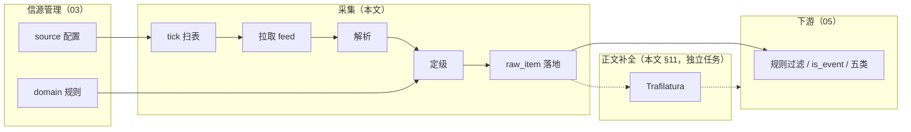

# 04-采集

> 版本：v0.2
> 日期：2026-11-26
> 范围：按信源声明把外部内容拉回来、解析、定级、落到 `raw_item`；正文抽取拆为独立任务
> 上游：[03-信源管理.md](./03-信源管理.md)（信源声明与定级规则）、[01-总体架构.md](../总体架构/01-总体架构.md)、[技术栈.md](../总体架构/技术栈.md)
> 下游：05-预处理与事件判定
> 非目标：内容判断、排除词过滤、`is_event` 判定、五类归类、AI 加工、事件级去重
> 对齐：[技术栈选型评估.md](../reference/技术栈选型评估.md)（见 §17）、[问题与决策.md](../reference/问题与决策.md)

---

## 0. 文档目的与立场

本文回答两个问题：

1. **怎么把"想要的信息"尽量不漏地拉回来，并且每条都能点回原文。**
2. **用什么样的代码结构实现它**（v0.2 新增，见 §1）。

核心矛盾是召回与精度。立场很明确：**采集阶段只保召回，精度全部交给下游。**

理由：漏采的内容永远回不来，多采的内容下游可以过滤掉；反过来不行。这也决定了后面所有设计——query 宁可宽一点，落地宁可多存一点，判错留给 05。

### 0.1 v0.2 相对 v0.1 的变化

v0.1 写于技术栈 v2.0 与实测之前，有 9 处偏差已修正，并新增了两章结构性内容：

| 类别 | 变化 |
|---|---|
| **新增 §1 实现方式** | 四层决策：进程模型 / 调度模型 / 并发模型 / 适配器模型；本轮核心 |
| **新增 §11 正文补全** | 正文抽取从采集主流程**拆出为独立任务**（决策 C1） |
| **新增 §17 对齐说明** | 与 `技术栈选型评估.md` 的逐条对应 |
| §6 调度 | 从"每源一个 job"改为**单一 tick 扫表**（决策 C2） |
| §4 适配器 | 从 3 个类合并为 **2 个类**（`FeedAdapter` + `ApiAdapter`） |
| §13.1 重试 | 3 次 2/4/8 s → **5 次 0.6—4 s 指数退避** |
| §7 超时 | 10 s / connect 5 s → **25 s** |
| §7 客户端 | 补**全局单 Client + 连接复用**（v0.1 缺） |
| §7 限速 | 同 host 2 s → **同 host 串行 + 1 s**；GN 2 s |
| §7 代理 | "代理是硬需求"→ **本机可直连**，代理改可选（实测结论） |
| §14.3 冒烟 | 删除"四层回溯降级"断言 → 改断言 `<source url>` 提取与 `rule6` 落表 |
| §16 写回 | 补 `last_error*` 三字段（03 v0.2 新增） |
| §13.3 状态 | 补 `starved`（空转）判定（03 v0.2 新增） |
| 规模 | "18 个源"→ **20 个** |

---

## 1. 实现方式（本轮核心）

### 1.1 四层结构一览

```
┌─ 进程层 ────────────────────────────────────────────┐
│  API 进程（uvicorn）        Worker 进程（python -m app.worker）│
│  不发 HTTP、不注册 job  ──►  唯一跑调度、唯一发 HTTP          │
│         └────── 共享同一套 app/ 代码，共享同一个 PostgreSQL ──┘
└──────────────────────────────────────────────────────┘
                          │
┌─ 调度层 ─────────────────────────────────────────────┐
│  APScheduler：只有 3 个固定 job，不随源数量变化           │
│    tick()          每 30s   查到期源 → 投递             │
│    poll_pending()  每 30s   捞 pending 任务 → 投递      │
│    fetch_full_text() 每 60s 捞待补正文 → 投递           │
└──────────────────────────────────────────────────────┘
                          │ 只投递，不执行
┌─ 并发层 ─────────────────────────────────────────────┐
│  ThreadPoolExecutor(max_workers=4)                   │
│  共用同一个 httpx.Client（连接复用）                    │
│  同 host 互斥锁保证串行                                │
└──────────────────────────────────────────────────────┘
                          │
┌─ 适配器层 ───────────────────────────────────────────┐
│  FeedAdapter   rss + google_news（feedparser 一套代码）│
│  ApiAdapter    api（本期只留桩，见 §4.3）              │
│  manual        不走适配器，走导入接口                  │
└──────────────────────────────────────────────────────┘
```

### 1.2 决策 1｜进程模型：API 与 Worker 分离

| 项 | 规定 | 理由 |
|---|---|---|
| Worker 是独立进程 | `python -m app.worker`，由 `start.ps1` 拉起 | `BackgroundScheduler` 随进程，进程挂调度就停 |
| **API 进程不注册任何 job** | 只读 `source` 表对外提供 CRUD | Uvicorn `--reload` 会重复注册 job，导致同一任务跑两遍 |
| API 进程**不发任何外部 HTTP** | "立即采集"只 `INSERT task_run(status='pending')` | 一次慢源请求会把整个后台卡住 |
| 两者共享代码 | 同一个 `app/` 包，同一套 models/services | 不拆微服务，不复制代码 |

### 1.3 决策 2｜调度模型：单一 tick 扫表，不是每源一个 job

**这是本轮最重要的结构决策。**

| | A. 每源注册 interval job | **B. 单一 tick job 扫表（采用）** |
|---|---|---|
| 源增删改 | 必须动态 `add_job` / `remove_job` | **零成本**，下一轮自动生效 |
| 重启后 | 要重新同步 20 个 job | **什么都不用做**，状态在 DB |
| "什么时候该跑"存在哪 | scheduler 内存 + DB（`last_poll_at`）**两处** | **只有 `last_poll_at` + `poll_interval_min` 一处** |
| 两处不一致的后果 | 改了间隔但 job 没更新 → 实际节奏错，且很难发现 | 不存在此问题 |
| 手动触发 | 与定时触发是两条路径、两套代码 | **`pending` 与到期走同一个队列、同一段执行代码** |
| 演示可观测性 | 20 个 job 的 next_run_time，难以展示 | 可显示"本轮到期 6 个源" |

**选 B 的核心理由**：架构定了「`task_run` 是唯一任务真相」，`技术栈选型评估.md` §3.5 也以此拒绝了 Scrapy（"两套调度器的直接后果是任务状态有两个真相"）。用 APScheduler 的 job 存一份"什么时候该跑"，就是在调度层再造一个真相。**B 把调度降级为"扫描 + 入队"，符合这条原则。**

`tick()` 的核心查询（30 秒一次，一条 SQL）：

```sql
SELECT s.id
FROM source s
WHERE s.enabled = true
  AND (s.last_poll_at IS NULL
       OR s.last_poll_at < now() - (s.poll_interval_min * interval '1 minute') * 0.9)
  AND NOT EXISTS (
        SELECT 1 FROM task_run t
        WHERE t.source_id = s.id AND t.status IN ('pending', 'running'))
ORDER BY s.last_poll_at NULLS FIRST;
```

三个细节：

1. **`* 0.9` 防抖**：避免 tick 边界导致的"差 3 秒不到期"而白等 30 秒。
2. **`NOT EXISTS` 排除已在队中的源**：这是幂等性的来源——tick 每 30 秒跑，但同一源不会被重复投递。
3. **`ORDER BY last_poll_at NULLS FIRST`**：新源优先，长期未跑的优先。

> **为什么不给每个源单独算 next_run**：那又回到"内存里存到期状态"。现在到期状态完全由 `last_poll_at + poll_interval_min` 推导，改间隔立刻生效，无需任何同步动作。

### 1.4 决策 3｜并发模型：tick 只派发，绝不执行

这里有个容易踩的坑：APScheduler 的 job 跑在它自己的线程池里。**如果 `tick()` 内部直接调 `poll_source()`，tick 会被慢源阻塞，后续 tick 全部延迟，整体节奏崩坏。**

正确写法：

```python
# app/worker.py 骨架
_executor = ThreadPoolExecutor(max_workers=CRAWL_SOURCE_CONCURRENCY)  # 4
_client = httpx.Client(          # 全局唯一，禁止每请求新建
    headers={"User-Agent": CRAWL_USER_AGENT},
    follow_redirects=True,
    timeout=httpx.Timeout(CRAWL_TIMEOUT_SECONDS, connect=10.0),
    limits=httpx.Limits(max_connections=8, max_keepalive_connections=8),
)

def tick():
    """30s 一次。只查表 + 投递，立即返回。"""
    for source_id in _find_due_sources():          # 见 §1.3 的 SQL
        _executor.submit(poll_source, source_id)    # 不 join、不 wait

def poll_pending():
    """30s 一次。后台'立即采集'产生的 pending 任务。"""
    for run_id in _find_pending_runs():
        _executor.submit(run_poll_task, run_id)

def fetch_full_text():
    """60s 一次。见 §11。"""
    for item_id in _find_items_need_full_text():
        _executor.submit(extract_full_text, item_id)
```

APScheduler 配置：

```python
scheduler = BlockingScheduler()   # Worker 主线程
scheduler.add_job(tick, "interval", seconds=30,
                  max_instances=1, coalesce=True, misfire_grace_time=300)
# 另外两个 job 同上
```

| 参数 | 值 | 理由 |
|---|---|---|
| `max_instances=1` | 单实例 | tick 自己重叠没有意义 |
| `coalesce=True` | 合并补跑 | 机器休眠后不要补跑 20 次 |
| `misfire_grace_time=300` | 5 分钟 | 默认 1 秒，休眠后错过的任务会全丢 |
| `BlockingScheduler` | 主线程阻塞 | 不用 `BackgroundScheduler`，避免主线程退出后调度静默停掉 |

**并发度 4 的依据**：纯 feed 拉取单源 0.5—1 s（握手抖动时含重试 2—3 s），20 源串行约 20—60 s/轮，并发 4 后 5—15 s，远小于最短 15 分钟的轮询间隔。取 4 而非更高，是因为再高会同时打多个 host，反而不礼貌且易触发限流。

### 1.5 决策 4｜适配器模型：从 3 个类合并为 2 个

v0.1 设计 `RssAdapter` / `GoogleNewsAdapter` / `ApiAdapter` 三个类。实际上 RSS 与 Google News 的**解析代码完全相同**（都用 feedparser），唯一差别是"出处域名从哪个字段取"——而这个差别 03 §4 已经定义成一张表了。

所以合并：

```python
class FetchContext(BaseModel):
    source: Source                  # 03 定义的配置
    client: httpx.Client            # 全局单例
    etag: str | None
    last_modified: str | None
    max_age_days: int

class RawItemDraft(BaseModel):
    source_id: int
    url: str                        # 原始链接（GN 为跳转链接）
    resolved_url: str | None        # rss 回溯结果；GN 恒为 None
    publisher_url: str | None       # GN 的 <source url>；rss 为 None
    publisher_name: str | None
    title: str
    summary: str | None
    content_encoded: str | None     # RSS 自带全文（NASA 约 23 KB/条）
    published_at: datetime | None
    published_raw: str | None
    author: str | None
    extra: dict
    fetched_at: datetime

class FetchResult(BaseModel):
    items: list[RawItemDraft]
    not_modified: bool = False
    error_kind: str | None = None   # connect/http_4xx/http_5xx/auth/parse/empty_feed
    stats: dict = {}


class FeedAdapter:                   # rss + google_news 共用
    def fetch(self, ctx: FetchContext) -> FetchResult: ...
    def origin_domain(self, item: RawItemDraft, source: Source) -> str | None:
        """按 source.type 分派，见 03 §4 与 §9.2。"""
```

**加一个源只改 seed 配置，不写代码；加一种"类型"才写适配器。** 不要把"加源"和"加代码"绑在一起，否则每接一个 Feed 都要发版。

### 1.6 决策 5｜正文抽取拆出主流程（C1）

这是本轮的分水岭决策。

| | A. 采集阶段同步抓正文 | **B. 采集只拉 feed，正文独立补全（采用）** |
|---|---|---|
| 单源耗时 | 30 条 × 0.2—6.7 s = **6—200 s** | **0.5—3 s** |
| 20 源一轮 | 串行不可行，必须高并发 | 并发 4 即可 |
| 失败归属 | 正文 403 会污染"采集任务是否成功" | **不影响 feed 落地** |
| 与 phys.org 403 的关系 | 403 拖进采集任务，源被判 degraded | 只写 `full_text_status='blocked'`，采集照常成功 |
| 与 sd_astronomy 4 次重试的关系 | 一条正文用掉 4 次尝试，拖慢整轮 | 在独立任务里消耗，不占采集配额 |

**实测依据**：`phys.org` 文章页 403、`sd_astronomy` 单条抓取用到 4 次重试才成功。这些都会污染"采集任务成败"这个判断。拆开之后：

- **采集任务的成败 = feed 能不能拉**（信号清晰，直接对应源健康度）
- **正文补全是另一个任务**，失败只影响该条 `full_text_status`，**不影响源健康度**

代价：多一个任务类型（`fetch_full_text`）+ 一个待补队列（用 `raw_item.full_text IS NULL AND full_text_status='pending'` 当队列，不新加表）。详见 §11。

---

## 2. 采集在链路中的位置



注意 `正文补全` 是**虚线旁路**：它不阻塞主链路，下游可以在正文未到时就先做规则过滤与 `is_event`（用标题 + 摘要）。

---

## 3. 设计原则

1. **先存后判。** 拉到的原样落库，哪怕明显是垃圾。判断是下游的事。
2. **宁可多采，不可漏采。** 见 §0。
3. **每条必能回溯线索。** 直连源保留原始 URL 与 canonical URL；Google News 无法回溯时，必须保留 `<source url>` 与跳转链（见 §10）。
4. **采集不碰 LLM。** 采集任务只写 `raw_item` 和 `article(status='ingested')`。
5. **失败可见。** 超时、403、格式错、空壳 feed 都有分类状态与记录，不静默吞（§14）。
6. **尊重目标站点。** 带真实 UA 和联系方式，遵守 `poll_interval_min`，同 host 串行。
7. **一个有损操作都不做。** 入口去重只按 URL 精确匹配；事件级合并是 06 的事（§10.3）。

---

## 4. 适配器

### 4.1 两个类 + 一个分派函数

| 适配器 | 用于 | 关键处理 |
|---|---|---|
| `FeedAdapter` | `type='rss'`、`type='google_news'` | `feedparser` 解析、编码修正、`bozo` 容错、`published_parsed` 直取、`content:encoded` 抽全文、GN 的 `<source url>` 提取 |
| `ApiAdapter` | `type='api'` | **本期只留桩**，见 §4.3 |
| 无 | `type='manual'` | 走 `POST /api/raw-items`，不经过适配器 |

### 4.2 `FeedAdapter` 的三个要点

**① 编码：先按 UTF-8 严格解，再嗅探**

不依赖服务器声明的 charset。实测 ScienceDaily 返回 `Content-Type: application/xml`（无 charset），但字节本身是合法 UTF-8，撇号是 U+2019。若按声明走或按本地代码页走，会出现乱码。

    def _decode(raw: bytes, resp: httpx.Response) -> tuple[str, str]:
        """返回 (text, decode_strategy)；strategy 落到 raw_item.extra 便于排障。"""
        try:
            return raw.decode("utf-8", errors="strict"), "utf-8-strict"
        except UnicodeDecodeError:
            pass
        declared = resp.encoding          # httpx 从 header 推的
        if declared and declared.lower() not in ("utf-8", "utf8"):
            try:
                return raw.decode(declared, errors="strict"), f"declared:{declared}"
            except (UnicodeDecodeError, LookupError):
                pass
        return raw.decode("utf-8", errors="replace"), "utf-8-replace"

`feedparser.parse()` 直接吃 `bytes` 也能自己嗅探，但**统一在适配器里解码后传 `str`**：这样 `decode_strategy` 可观测，也避免两处解码逻辑不一致。

**② `bozo` 不能一票否决，要区分 `not_a_feed` 与 `empty_feed`**

`技术栈选型评估.md` §6.2 已定这条。四个象限的处理完全不同：

| `bozo` | `entries` | 判定 | `error_kind` | 处置 |
|---|---|---|---|---|
| `False` | 大于 0 | 正常 | `None` | 继续 |
| `False` | 0 | **空壳 feed** | `empty_feed` | `task_run='success'`，不累加失败；连续 3 次 → `starved` |
| `True` | 大于 0 | 半坏但能用 | `None`（记 warn 日志） | 继续，`stats.bozo=1` |
| `True` | 0 | **不是 feed** | `parse` | `task_run='failed'`，累加 `consecutive_failures` |

`bozo_exception` 原文写入 `source.last_error`，便于判断"是不是换成 HTML 了"。

**③ `content:encoded` 优先，减少详情页抓取**

NASA 的 `content:encoded` 单条约 23 KB（实测），**有就直接用，不再抓详情页**（对应 `技术栈.md` §5.6 第 1 条）。feedparser 里取 `entry.content[0].value`，写入 `raw_item.content_encoded`，`full_text_status='skipped'`。

### 4.3 `ApiAdapter` 本期只留桩

按决策 C3：`tianapi_science` 需要 key 且原地址 404，**写了也无法验证**。

    class ApiAdapter:
        def fetch(self, ctx: FetchContext) -> FetchResult:
            # 决策 C3：本期不实现，等真有 key 再说
            return FetchResult(
                items=[],
                error_kind="auth",
                stats={"reason": "api_adapter_not_implemented"},
            )

`type='api'` 的源在 seed 里 `enabled=false`，状态会自然停在 `auth_error`，UI 显示"需要凭据"。**不写半成品代码，也不假装支持。**

### 4.4 不做浏览器渲染

如果某源只有 JS 渲染页面、没有 RSS/API，**MVP 阶段直接放弃**。

理由：Playwright 会拖入浏览器二进制（约 200 MB）、反爬对抗和不稳定的 CI，收益远小于成本。这是 `技术栈.md`「不引入 Playwright」与 `技术栈选型评估.md` §3.3（Crawl4AI 后置）的延续。**触发重启条件写在 §17.3。**

---

## 5. 如何采集到「想要的信息」

这一节解决"拉对东西"。前面的适配器解决"能拉"。

### 5.1 召回漏斗：采集只负责最上两层

    事件锚定词命中 ──┐
                     ├──> 【本文负责】采集范围
    时间窗内         ──┘
                     │
                     ├──> 【05 负责】排除词过滤（教程/广告/星座/影视）
                     ├──> 【05 负责】is_event 判定
                     ├──> 【05 负责】五类归类
                     └──> 【06 负责】事件级去重

采集只负责"关键词命中 + 时间窗"。这两层决定下游的天花板：**如果某类事件没有任何锚定词覆盖，后面所有环节都补不回来。**

### 5.2 两组词，角色完全不同

**第一组：事件锚定词（作为主查询条件）**

| 栏目 | 中文锚定词 | 英文锚定词 |
|---|---|---|
| 深空 / 粒子 | 中微子、江门中微子、幽灵粒子、暗物质、引力波 | neutrino、JUNO、IceCube、dark matter、gravitational wave |
| 近地天体 | 小行星、近地天体、飞掠、潜在威胁 | asteroid、NEO、flyby、PHA、potentially hazardous |
| 新星球 / 类地行星 | 类地行星、系外行星、宜居带、地球2.0 | exoplanet、habitable zone、Earth-like、super-Earth |
| 脑机 / 意识 | 脑机接口、意念控制、脑电、脑控 | BCI、brain-computer、brain-machine、EEG control |
| 异常 / 灵能 | 灵异、通灵、道士、术数、超自然 | paranormal、psychic、UFO、UAP、medium |

**第二组：泛宇宙信号词（只加分，不作主查询条件）**

宇宙、深空、维度、意识、量子、引力波、暗物质、外星、地外、异常、未知信号、无法解释、首次、突破

需求原话是"信号词只用于加分或后置重排，不作为宽泛布尔查询的主条件"。**这条必须守。** 用"首次"去搜 Google News 会返回上万条娱乐新闻，把真正的天文学事件全淹掉。

| 组 | 角色 | 存在哪 |
|---|---|---|
| 锚定词 | **查询条件**，决定"采不采得到" | `source.query_template` |
| 信号词 | **下游加分项**，决定排序与优先级 | `keyword_rule(type='signal')`，交 05/06 用 |

### 5.3 Google News query 构造

**基础模板**

    https://news.google.com/rss/search?q=<QUERY>&hl=zh-CN&gl=CN&ceid=CN:zh-Hans

**五条构造规则**

1. **一个 query 只覆盖一个栏目。** 跨栏目 OR 会稀释结果；`when:` 限制下结果数有上限，容易互相挤掉。
2. **同义词用 `OR` 连接，多字词用双引号包住。**
3. **中文、英文分两条。** 混排时搜索引擎会偏向某一语种。
4. **结尾加 `when:2d`**，保证增量、不吃历史堆积。
5. **要排除的用减号**，如 `-星座 -运势`。这一层只排"明显噪音"，精细排除交给 05。

**六条 query**

| 编号 | 源 code | 栏目 | QUERY |
|---|---|---|---|
| Q1 | `gn_particle` | 深空 / 粒子 | `(中微子 OR 江门中微子 OR 幽灵粒子 OR 暗物质 OR 引力波) when:2d` |
| Q2 | `gn_asteroid` | 近地天体 | `(小行星 OR 近地天体 OR 飞掠 OR "潜在威胁") when:2d -星座` |
| Q3 | `gn_exoplanet` | 新星球 / 类地行星 | `(类地行星 OR 系外行星 OR 宜居带 OR "地球2.0") when:2d` |
| Q4 | `gn_bci` | 脑机 / 意识 | `(脑机接口 OR 意念控制 OR 脑电 OR 脑控) when:2d -预售 -广告` |
| Q5 | `gn_paranormal` | 异常 / 灵能 | `(灵异 OR 通灵 OR 道士 OR 术数 OR 超自然) when:2d -小说 -电影 -股份 -证券` |
| Q6 | `gn_ufo` | 异常 / 灵能 | `(UFO OR UAP OR "不明飞行物") when:2d` |

> **实测修正（2026-11-25）**：六条 query 全部跑通，但 **Q5 基本失效**——`通灵` 命中上市公司「通灵股份 301168」「莱绅通灵 603900」，16 条约 13 条是股票新闻；`超自然` 命中游戏《超自然行动组》。本版已加 `-股份 -证券`，但**预期仍不理想**：这类词在中文搜索里的语义歧义是结构性的。Q5 作为 **S6 内容跑偏样本**保留（见 03 §5.4），靠"有效条数比例"暴露问题，而不是假装它能用。

其余五条可用：Q3 条数偏少（5 条）、Q4 量大量噪（65 条）。详见 [05-采集数据测试.md](./05-采集数据测试.md) §2.5。

`query_template` 存 QUERY 部分，`url` 存拼好的完整地址。

**改 query 的纪律**

- 改 query 等于改召回，**必须留痕**（`source.query_template` + `updated_at`），否则某天采集量突变无法追溯。
- 加词优先，删词谨慎。删词前先看 `raw_item` 里被该词命中的条目有没有下游真正用上的。
- 一次只改一条 query，观察 3 天再改下一条。同时改 6 条，出了问题定位不了。

### 5.4 三套时间机制别搞混

| 机制 | 字段 / 位置 | 作用 | 谁管 |
|---|---|---|---|
| 请求级增量 | `etag` / `last_modified` | 内容没变返回 304，省带宽和时间 | 采集 |
| 查询级增量 | `query_template` 里的 `when:2d` | 只取近 2 天的条目 | 采集 |
| 落地级窗口 | `MAX_AGE_DAYS`（默认 3） | 早于窗口的不写 `raw_item` | 采集 |
| **业务时效** | `publish_time` / `event_time` | **48 小时内才可推送** | **06-去重与时效** |

为什么 `when:2d` 配 `MAX_AGE_DAYS=3`：query 侧留 2 天，吃掉搜索引擎的索引延迟；落地侧放到 3 天，吃掉时区差和慢更新源。两个值都可配。

**时间窗不是业务时效判断。** 业务要求 48 小时内推送，那是下游时效门禁的事。这两件事混在一起，会导致"因为要控制库体积，把本该推送的新闻挡掉了"。

### 5.5 已知漏采风险

| 风险 | 后果 | 对策 |
|---|---|---|
| ~~Google News 境内不可达~~ | — | **实测本机可直连**（见 §7.6），此风险不成立 |
| `when:2d` 太短，事件第 3 天才被报道 | 漏采 | 关键栏目放宽到 `when:3d`，靠落地窗口挡历史 |
| 中文锚定词不全（如只写"小行星"） | 漏掉"近地天体""飞掠"表述 | 同义词组必须写全，见 §5.2 |
| RSS 源改版 | 某源静默 0 条 | 连续 3 次 `empty_feed` → `starved`（§13.3） |
| A 级源发稿频率低 | 长时间无新条目 | 正常现象，**不告警** |

最后一条要特别强调：**"成功但 0 条"和"请求失败"是两种完全不同的状态，绝不能合并成一个失败计数。** 前者说明源正常只是没新闻，后者说明源坏了。合并之后，一个低产但健康的源会被误判成故障，运维就去修一个没坏的东西。

区分方法：`task_run.status='success'` 且 `stats.fetched=0` 记为 `empty_feed`；只有 `status='failed'` 才累加 `consecutive_failures`。

---

## 6. 单次采集流程

结构见 §1.3 / §1.4。这里只写单次执行体做什么。

    poll_source(source_id)
      ├─ 1. 前置检查（tick 已过滤，这里是二次保险）
      │      source.enabled = false            → skip
      │      now - last_poll_at < interval*0.9 → skip（防抖）
      │      已有同源 task_run 在 pending/running → skip
      ├─ 2. 建 task_run(status='running', triggered_by='scheduler')
      ├─ 3. adapter.fetch(ctx)
      │      304                    → success, stats={not_modified:true}，结束
      │      error_kind='auth'      → failed, health_status='auth_error'，不重试
      │      其他 error_kind        → 见 §13
      ├─ 4. 逐条定级 + 落库（§9）
      ├─ 5. 写回 source：
      │      etag / last_modified / last_poll_at / last_success_at（成功时）
      │      success_count 或 error_count、consecutive_failures
      │      health_status、last_error / last_error_at / last_error_kind
      └─ 6. 关闭 task_run，写 stats_json

**`poll_pending` 与 `tick` 的区别只有一个**：`task_run` 已由 API 建好（`status='pending'`, `triggered_by='manual'`），执行体直接把它改成 `running` 再走第 3 步之后。**两条路径共用同一段执行代码**，不复制。

**Worker 启动时的清理**：把 `status='running'` 且 `started_at < now() - 30min` 的 `task_run` 标为 `failed`，`error='worker restarted'`。否则进程被杀后任务会永远卡在 running，`NOT EXISTS` 判断会让该源再也不被调度——这是单一 tick 模型必须配套的一步。

---

## 7. HTTP 抓取规范

### 7.1 参数表

> 全部对齐 [技术栈.md](../总体架构/技术栈.md) §5.5，不在此处另立数值。

| 项 | 规定 | 环境变量 |
|---|---|---|
| 客户端 | **全局单例** `httpx.Client`，`max_connections=8`、`max_keepalive_connections=8`；`http2=False` | — |
| 超时 | `httpx.Timeout(CRAWL_TIMEOUT_SECONDS, connect=10.0)` | `CRAWL_TIMEOUT_SECONDS=25` |
| UA | `CRAWL_USER_AGENT`，形如 `MysteryNewsDemo/1.0 (+mailto:xxx@example.com)` | `CRAWL_USER_AGENT` |
| 条件请求 | 带 `If-None-Match` / `If-Modified-Since`；**304 视为成功** | — |
| 重试 | tenacity：**5 次**，`wait_exponential(multiplier=0.6, min=0.6, max=4)`；可重试异常 `ConnectError`/`ConnectTimeout`/`ReadTimeout`/`RemoteProtocolError`；可重试状态码 429/500/502/503/504；429 额外读 `Retry-After` | `CRAWL_MAX_ATTEMPTS=5` |
| 不重试 | 其余 4xx、解析错误、业务错误 | — |
| 并发 | `ThreadPoolExecutor(max_workers=4)`；**同 host 互斥串行** | `CRAWL_SOURCE_CONCURRENCY=4` |
| 限速 | 同 host 最小间隔 **1 s**；Google News **2 s**（同 host 6 个源，易撞 429） | — |
| 响应大小 | 超 `MAX_RESPONSE_BYTES`（5 MB）截断并记 warning | `MAX_RESPONSE_BYTES` |
| 编码 | 见 §4.2 ① | — |
| robots.txt | 读 `{scheme}://{host}/robots.txt`，命中 `Disallow` 记日志并在 Dashboard 标黄，**不阻断** | — |
| 代理 | **可选**，读 `HTTP_PROXY` / `HTTPS_PROXY`，为空则直连 | 可选 |

### 7.2 同 host 串行怎么实现

6 个 GN 源共用一个 host。并发 4 时若不限制，最多 4 个请求同时打 `news.google.com`，必然 429。

    _host_locks: dict[str, threading.Lock] = defaultdict(threading.Lock)
    _host_last: dict[str, float] = defaultdict(float)

    def _guarded_get(client, url, host, min_interval):
        with _host_locks[host]:
            wait = min_interval - (time.monotonic() - _host_last[host])
            if wait > 0:
                time.sleep(wait)
            try:
                return client.get(url)
            finally:
                _host_last[host] = time.monotonic()

**注意锁包住的是"等待 + 请求"整体**，不是只包 sleep——否则两个线程会同时算出"不用等"然后一起发。

### 7.3 为什么不做 TLS 版本特殊处理

实测：强制 `maximum_version=TLSv1_2` 对失败率**无改善**（nasa 2/6、fnal 2/6，与默认一致），问题不在 TLS 版本而在握手期被丢弃。加这层配置只增加复杂度。**遇到握手失败就交给 tenacity 重试**（实测单次 3/5 → 带重试 5/5）。

### 7.4 不要伪装浏览器 UA

`atel` 实测浏览器 UA 也返回 403——它需要 token，不是反爬。伪装 UA 除了让自己看起来像爬虫，没有任何收益。这条也是 `技术栈选型评估.md` §6.4「不参考反爬绕过技巧」的落地。

### 7.5 robots.txt 只观测不阻断

MVP 目标是演示与内部审核，不是公网服务。命中 `Disallow` 时记日志 + Dashboard 标黄，让人知情；强行阻断会让部分源直接不可用（演示价值归零），而我们的请求频率（30—120 分钟一次）远低于普通爬虫。

### 7.6 代理是可选项，不是硬需求

v0.1 写"能否走通代理直接决定演示有没有真实采集画面"，**实测证伪**：本机可直连 `news.google.com`，NASA / Fermilab / phys.org / ScienceDaily / watchers 全部可直连。失败是**出网握手抖动**（`SSL: UNEXPECTED_EOF_WHILE_READING`），连 Google 也一样，不是墙。

---

## 8. 解析与标准化

### 8.1 中间结构

见 §1.5 的 `RawItemDraft` / `FetchResult`。**所有适配器的输出都先收敛到这个结构**，后面的定级、落库只认这一种形状。

两个新增字段（相对 v0.1）：

| 字段 | 为什么加 |
|---|---|
| `publisher_url` / `publisher_name` | GN 的 `<source url>`。定级靠它，不靠 `resolved_url`（那条路已死，见 §9.1） |
| `content_encoded` | RSS 自带全文。有了就不抓详情页（§11.2） |

### 8.2 标题 / 摘要清洗

只去噪，不改写：

- 去 HTML 标签（feed description 常带 `<p>`、``）。**注意 GN 的 `<description>` 是转义 HTML**（`&lt;a href=...&gt;`），需先 unescape 再剥标签。
- 去后缀：按 `source.title_suffix_rules` 去掉「- NASA」「| phys.org」这类尾巴。
- 合并连续空白，Unicode NFKC 规范化。
- `raw_item.raw_title` 保留原样，清洗结果进 `article.title`。

**保留原始标题是必须的**：审核员要对照原文，被清洗过的标题看不出原文长什么样。

### 8.3 时间解析

1. `feedparser` 给出 `published_parsed`（struct_time）→ 直接用，`calendar.timegm()` 转 UTC。
2. 否则 `dateutil.parser.parse(published_raw, dayfirst=False)`。
3. 再失败 → `published_at=None`、`extra.time_parse_failed=True`，下游归入待定。
4. **无时区的按 UTC 处理**，记 `extra.tz_assumed='UTC'`。

第 4 条选择 UTC 而不是本地时区，是为了让"无时区"和"有时区"的处理结果一致——都落在 UTC 坐标系里，下游算 48 小时窗口时不会因为时区假设不同而差出 8 小时。

实测三种时区写法都要能处理：`+0000`（NASA / Fermilab）、`GMT`（Google News）、**`EST`（phys.org / ScienceDaily）**。`published_parsed` 已覆盖，不需要额外处理。

---

## 9. 链接与定级

### 9.1 Google News 不回溯（已实测）

Google News 的 `<link>` 是 `https://news.google.com/rss/articles/CBMi...?oc=5` 形式的跳转链接。原计划的三级回溯策略**全部失效**，证据见 [05-采集数据测试.md](./05-采集数据测试.md) §3.5：

| 原策略 | 实测结果 |
|---|---|
| base64 本地解码出原始 URL | 解码成功，但内容是新格式 ID，**不含 http 地址** |
| HEAD 跟随读 `Location` | 返回 **204，无 Location** |
| GET 解析页面找 `data-n-au` | 200，607 KB，**页面中不存在该属性**（Angular SPA 壳） |
| Google `batchexecute` 接口 | 200，但返回空结果 `[3]` |

**现行方案：不回溯，改用条目自带的 `<source url>`。**

    def get_publisher(entry) -> tuple[str | None, str | None]:
        """从 Google News entry 提取 (publisher_name, publisher_url)，零网络开销。"""
        src = entry.get("source") or {}
        return src.get("title"), src.get("href")

实测 44/44 条都带 `source.href`（feedparser 把 `<source url="...">` 解析成 `entry.source.href`）。样例：`entry.source.href = https://www.cast.org.cn`、`entry.source.title = 中国科学技术协会`。

- `resolved_url` 置 `None`，`article.resolve_status='unresolved'`。
- 定级用 `publisher_url` 的域名，规则见 03 §6。
- `raw_item.url` 保留跳转链接，人工审核时点开核对。
- `<source url>` 缺失时 → 按规则 1 判 C 并进待定池。

**这不是降级：定级精度不受影响，只是少了"一键跳原文"的便利，而人工审核本来就要看一眼原文。**

### 9.2 出处域名怎么取（定级的前置）

这是 03 §4 那张表的实现，**不是"统一用 resolved_url"**：

| `source.type` | 取哪个字段 | 为什么 |
|---|---|---|
| `google_news` / `api` | **只取 `publisher_url`** | 它们的 `url` 域名恒为 `google.com` / 聚合站，用 `url` 兜底会把 44 条全判成同一级 |
| `rss` / `manual` | `resolved_url`，空则 `url` | 直连源，`url` 就是它自己的域名，可以兜底 |
| 任一都取不到 | 返回 `None` → 规则 1 判 C | fail-safe |

    def origin_domain(item: RawItemDraft, source: Source) -> str | None:
        if source.type in ("google_news", "api"):
            raw = item.publisher_url
        else:
            raw = item.resolved_url or item.url
        return registrable_domain(raw) if raw else None

### 9.3 直连源的 URL 归一化

- 直连源：`article.original_url = link`，`canonical_url = canonicalize(link)`。
- 跳转源：`article.original_url = None`，`canonical_url = None`，`url_hash` 基于跳转链接算。
- `canonicalize()` 去掉 `utm_*`、`ref`、`spm`、`from` 等追踪参数（只删参数，不改路径与协议）。
- **拿到 publisher 域名不等于直接定级**，仍按 03 §6 六步链算：落到 A 级媒体就升，落到未收录域名就 C。

### 9.4 定级函数签名

    def grade_article_source(item: RawItemDraft, source: Source) -> tuple[str, str]:
        """返回 (level, reason)。规则见 03-信源管理 §6 六步判定链。"""

**必须传整个 `item`，不能只传 `resolved_url`。** GN / API 源的 `resolved_url` 恒为 `None`，出处域名只能从 `publisher_url` 取。v0.1 那版只传 `resolved_url`，会让 6 个 GN 源的所有文章都命中规则 1 判成 C——B 级主路径直接断掉。

`reason` 格式 `rule{N}:{domain}`，必须拼命中域名，因为审核台要直接展示它。

---

## 10. 落地与入口去重

### 10.1 处理顺序

对每条 `RawItemDraft`：

1. `published_at` 早于 `now - MAX_AGE_DAYS` → 计 `skipped_old`，跳过。
2. 取出处域名（§9.2）→ 定级（§9.4）→ 得 `level` / `reason`。
3. 算指纹：
   - `url_hash = sha256(canonical_url or resolved_url or publisher_url or url)`
   - `content_hash = sha256(normalize(title) + '|' + normalize(summary))`
   - `title_fingerprint = normalize(title)`
4. 查 `article` 是否已有同 `url_hash`：有 → 计 `skipped_dup`，把本次 `source_id` 追加到 `article.dup_sources`。
5. 写 `raw_item`（唯一约束 `(source_id, url_hash)` 兜底），写 `article` 骨架（`status='ingested'`）。
6. 若 `content_encoded` 有值 → `full_text` 直接写入、`full_text_status='skipped'`；否则 `full_text_status='pending'`，等 §11 补。

### 10.2 `stats` 计数

写入 `task_run.stats_json`：

| 键 | 含义 |
|---|---|
| `fetched` | 解析出的条目数（`len(feed.entries)`） |
| `inserted` | 新写入 `raw_item` 数 |
| `skipped_dup` | 已有同 `url_hash` 而跳过 |
| `skipped_old` | 超 `MAX_AGE_DAYS` 而跳过 |
| `not_modified` | 304 |
| `bozo` | 0/1 |
| `attempts` | 本次任务实际 HTTP 尝试次数（**用于验证重试是否生效**） |
| `error_kind` | 失败时的分类 |

### 10.3 只做入口去重，不做事件级去重

同一颗小行星被 4 家媒体报道，在这一步是 4 条 `article`；把它们合并成 1 个 `event_cluster` 是 06 的事。

**为什么不合并做**：采集阶段一旦合错，原始数据就丢了，找不回来；而下游合并合错可以重跑。**有损操作必须放在能重跑的位置。** 这与 `技术栈选型评估.md` §5「复用边界」是同一条思路：不可逆的环节只做无损判断。

---

## 11. 正文补全（独立任务）

### 11.1 为什么独立

见 §1.6 的决策对比。核心一句：**把"feed 能不能拉"与"正文能不能抽"分成两个信号**，前者决定源健康度，后者只决定单条的 `full_text_status`。

### 11.2 四级回退链

对齐 [技术栈.md](../总体架构/技术栈.md) §5.6：

| `full_text_status` | 条件 | `full_text` 内容 | 是否影响源健康度 |
|---|---|---|---|
| `skipped` | RSS 自带 `content:encoded`（NASA 约 23 KB/条） | 直接用，**不抓详情页** | 否 |
| `ok` | Trafilatura 抽出 200 字及以上 | 抽取结果 | 否 |
| `blocked` | HTTP 401/403/451（实测 phys.org 文章页 403） | 回退 RSS `summary` | **否** |
| `thin` | 抽出少于 200 字 | 回退 RSS `summary` | 否 |
| `pending` | 待补 | `NULL` | 否 |

### 11.3 待补队列（不新加表）

用 `raw_item` 自身当队列：

    SELECT id FROM raw_item
    WHERE full_text_status = 'pending'
      AND url IS NOT NULL
    ORDER BY fetched_at ASC
    LIMIT 20;

`fetch_full_text` 每 60 秒跑一次，每次最多取 20 条，丢进同一个线程池。取不到的把 `full_text_status` 置 `blocked`/`thin` 终态，**不会无限重试**。

**为什么给 `LIMIT 20`**：单条正文抓取最坏 6.7 s（实测 sd_astronomy），20 条并发 4 约半分钟。不限量会让一轮补全把时间全吃掉，挤压采集。

### 11.4 Trafilatura 参数

对齐 `技术栈选型评估.md` §6.3：

    text = trafilatura.extract(
        html,
        favor_precision=True,
        include_comments=False,
        include_tables=False,
    )

**不借它的 `fetch_url` / 批量下载功能**——抓取仍由我们自己的 `httpx + tenacity + 同 host 锁` 负责，否则重试、UA、超时、`task_run` 记录会出现两套。

### 11.5 下游怎么用

`blocked` / `thin` **不阻断后续流程**：`is_event`、五类判定、事实锚点都可以只用标题 + 摘要完成，只是审核台要提示"未取得全文"，并给出原链接。

这条对应的产品判断在 03 §5.4 也写过：S6 内容跑偏靠"有效条数比例 + 采回条目判定结果"暴露，而不是靠正文。

---

## 12. 手工导入

用途：C 级线索、演示兜底、补齐验收用例（如"泰国道士综艺"）。

`POST /api/raw-items`

    {
      "url": "https://weibo.com/xxx/123",
      "title": "中国道士参加泰国灵异综艺",
      "summary": "……",
      "published_at": "2026-11-24T10:00:00Z",
      "source_code": "manual",
      "note": "C 级线索，待 B 级以上来源确认"
    }

- `url` 必填，走与自动采集**完全相同**的定级流程，**不开后门**。
- `source_id` 固定挂到 `code='manual'` 的源上，保证 `raw_item.source_id` 有归属。
- 同样写 `raw_item` + `article(status='ingested')` + `full_text_status='pending'`，进主流水线。
- 记 `review_action(action='manual_import')`，含操作人。

**设计上要防一件事：手工导入不能成为绕过审核的通道。** 它只影响"这条怎么进来的"，不影响后面任何一道闸门——定级、过滤、`is_event`、人工审核照样走。

---

## 13. 失败处理

### 13.1 错误分类（与 `last_error_kind` 对齐）

六种取值与 03 §7.5 完全一致，不另立枚举：

| `error_kind` | 触发 | 重试 | `task_run` | `consecutive_failures` | `health_status` |
|---|---|---|---|---|---|
| `connect` | 连接失败 / 超时 / TLS 握手失败 | 5 次退避 | `failed` | +1 | 按阈值 |
| `http_4xx` | 400 / 404 / 410 等 | 否 | `failed` | +1 | 按阈值 |
| `http_5xx` | 500 / 502 / 503 | 是（含在 5 次内） | `failed` | +1 | 按阈值 |
| `auth` | 401 / 403 | **否** | `failed` | 不适用 | **直接 `auth_error`** |
| `parse` | `bozo=1` 且 0 条 | 否 | `failed` | +1 | 按阈值 |
| `empty_feed` | 200 且解析成功但 0 条 | 否 | **`success`** | **不加** | 连续 3 次 → `starved` |
| 本地错误 | DB 写失败、编码异常 | 否 | `failed` + traceback | **不加** | 不变 |

**本地错误绝不能计入源健康度**——那不是源的问题，计入后会让人去修一个没坏的源。

### 13.2 `task_run` 记录

每次任务一条：`task_type`、`source_id`、`status`、`started_at`、`finished_at`、`stats_json`、`error`（截断 2000 字符）、`triggered_by`。

`triggered_by` 三个取值：`scheduler` / `manual` / `startup`。这是给排查用的：演示时点了"立即采集"，能立刻从 `task_run` 看出是人点的还是调度跑的，不用猜。

`task_type` 三个取值：`poll`（拉 feed）/ `fetch_full_text`（补正文）/ `recalc_levels`（重算等级，03 定义）。

### 13.3 状态迁移（与 03 §7 对齐）

| 迁移 | 触发 |
|---|---|
| 任意 → `auth_error` | `error_kind='auth'`，**只能人工重置** |
| 任意 → `degraded` | `consecutive_failures >= 3` |
| 任意 → `down` | `consecutive_failures >= 10` |
| `ok` → `starved` | 连续 3 次 `empty_feed` |
| 任意 → `ok` | 一次成功且 `fetched > 0` |
| `starved` → `ok` | 采回 1 条及以上 |
| `disabled` → `degraded` | 后台重新启用（**不直接给 `ok`**） |

`consecutive_failures` **按任务级计数**：一次任务重试到最终仍失败才 +1，成功即清零。若按 HTTP 请求级算，一次任务失败会被记 5 次，`degraded >= 3` 在单次任务内就触发，阈值形同虚设。

---

## 14. 采集质量怎么验证

采集做得好不好，不能用"跑起来了"判断，得看数。

### 14.1 每次任务就能看的

| 指标 | 参考值 | 异常含义 |
|---|---|---|
| `stats.fetched` | A 级源 10—60 条；GN 每条 query 5—65 条 | 远低于此说明解析可能坏了 |
| `stats.inserted` | 首拉接近 `fetched`，之后每天新增有限 | — |
| `skipped_old` 占比 | 首拉会高，稳定后接近 0 | 持续偏高说明窗口配错 |
| `skipped_dup` 占比 | 稳定在 30%—70% | 见下 |
| `stats.attempts` | 多数为 1，少数 2—4 | **长期为 5 说明网络或源有问题** |
| 单源耗时 | 小于 5 s（纯 feed） | 超时说明该加条件请求或换源 |

`skipped_dup` 的两种异常方向要会区分：

- **长期 100%**：这个源基本没更新，可以拉长间隔。
- **长期 0% 且 `inserted` 很高**：警惕 `url_hash` 算错了（比如带随机 query 参数），导致重复内容被当成新条目。

### 14.2 每周抽样核对

从 `raw_item` 随机抽 20 条，人工判三件事：

1. 这条真的是新闻事件吗？（不是纯科普 / 广告 / 运势）
2. 是不是符合栏目五类之一？
3. `raw_item.url` 点开**能不能对上内容**？（GN 是跳转链，点开应到原文）

**第 3 项是采集独占的责任**——点不开就是采集的 bug，不是下游的。第 1、2 项错判属于下游过滤器，但抽样时要顺手记录"这条本来该被采到却漏了"，那是 query 该加词的信号。

### 14.3 自动化冒烟

`pytest` + `respx`：

- 用 `fixtures/feeds/` 里的固定 RSS 样本喂 `FeedAdapter`，断言解析出正确条数与字段。
- **断言 GN 样本能取出 `entry.source.href`**（不是断言"四层回溯降级"——那条路已废弃）。
- **断言 `<source url>` 缺失时判 C 且 `reason` 以 `rule1` 开头**。
- **断言 `rule6` 触发时 `unknown_domain` 被 upsert**（这是 03 §6.6 的写入点）。
- 用 `freezegun` 固定时间断言 `MAX_AGE_DAYS` 窗口。
- **断言 `bozo=1 且 entries=0` 归为 `parse`，`bozo=0 且 entries=0` 归为 `empty_feed`**。
- **测试不访问真实网络、不调真实 LLM。**

### 14.4 覆盖度反向检查

提交前做一次：拿需求文档 §10 的验收用例反推——"如果这条新闻真的发生了，我们哪个源 / 哪条 query 会采到它？"

答不上来的用例，说明召回有洞，要么补源、要么补词、要么明确写"只能手工导入"。这张反推表比任何覆盖率数字都有用。

---

## 15. 配置项

| 变量 | 默认 | 说明 | 来源 |
|---|---|---|---|
| `CRAWL_USER_AGENT` | `MysteryNewsDemo/1.0 (+contact)` | 抓取标识 | 技术栈 §8 |
| `CRAWL_MAX_ATTEMPTS` | `5` | 单 URL 重试次数 | 技术栈 §8 |
| `CRAWL_TIMEOUT_SECONDS` | `25` | 单请求超时 | 技术栈 §8 |
| `CRAWL_SOURCE_CONCURRENCY` | `4` | 源间并发度 | 技术栈 §8 |
| `MAX_AGE_DAYS` | `3` | 落地窗口 | 本文 |
| `MAX_RESPONSE_BYTES` | `5242880` | 响应上限 5 MB | 本文 |
| `HOST_MIN_INTERVAL_SEC` | `1` | 同 host 最小间隔 | 本文 |
| `GOOGLE_NEWS_MIN_INTERVAL_SEC` | `2` | GN 额外间隔 | 本文 |
| `FULL_TEXT_BATCH_SIZE` | `20` | 每轮补正文条数 | 本文 |
| `HTTP_PROXY` / `HTTPS_PROXY` | 空 | **可选**，境外源不通时才配 | 本文 |
| `REPLAY_MODE` | `false` | 演示回放开关 | 技术栈 §8 |

`REPLAY_MODE` 要特别说一句：**回放只能替换外部 IO（拉取与 LLM 调用），不能绕过任何闸门。** 状态流转、定级、去重、审核必须走同一条代码路径。否则演示时看着通，真实数据来了就崩。

---

## 16. 与信源管理的接口

| 方向 | 内容 |
|---|---|
| 采集读取 | `source` 全部配置字段、`source_domain_rule` 定级规则 |
| 采集写回 | `etag`、`last_modified`、`last_poll_at`、`last_success_at`、`consecutive_failures`、`success_count`、`error_count`、`health_status`、**`last_error`**、**`last_error_at`**、**`last_error_kind`** |
| 采集写 `raw_item` | `url`、`resolved_url`、`publisher_url`、`publisher_name`、`raw_title`、`raw_summary`、`content_encoded`、`full_text`、`full_text_status`、`fetched_at`、`extra` |
| 采集写 `article` | `raw_item_id`、`source_level`、`source_level_reason`、`resolve_status`、`status='ingested'` |
| 采集写 `unknown_domain` | 规则 6 触发时 upsert（`hit_count+1`、`last_seen_at`、`sample_*`） |
| 接收指令 | **`task_run` 表**：`tick` 自己建 `scheduler` 任务；API 插 `pending`+`manual` 由 `poll_pending` 捞 |
| 接收指令 | `POST /api/sources/validate` 批量探活：**复用适配器解析逻辑但不落库**，参数独立（超时 8 s、重试 1 次），见 03 §8.4 |

`last_validated_at` 由探活写，不是采集写——探活是只读检查，不产生 `task_run`。

---

## 17. 与选型评估的对齐说明

用户要求"对齐技术栈选型评估"。这一节逐条列出本文如何落地那份文档的结论，避免两处口径不一致。

### 17.1 直接约束本文的条目

| 选型评估位置 | 原文结论 | 本文落点 |
|---|---|---|
| §3.5 Scrapy | "两套调度器的直接后果是任务状态有两个真相" | 决策 C2：**单一 tick 扫表**，到期状态只存 `last_poll_at` 一处（§1.3） |
| §3.6 Trafilatura | "不借它的 `fetch_url` / 批量下载"，抓取由自己的 httpx + tenacity 负责 | §11.4：只调 `trafilatura.extract()`，抓取走 §7 |
| §3.6 Trafilatura | "单通道 + 明确回退链，比双通道更可控" | §11.2 四级回退链 `skipped/ok/blocked/thin` |
| §3.3 Crawl4AI | "当 Trafilatura 成功率低于 80%，或出现必须 JS 渲染的源，再评估" | §4.4 + §17.3 触发条件 |
| §6.2 feedparser | "`bozo` / `bozo_exception` 用来区分 `not_a_feed` 与 `empty_feed`" | §4.2 ② 四象限表 |
| §6.2 feedparser | "`entry.source` 取媒体域名（实测 44/44 可取）" | §9.1 `get_publisher()` |
| §6.3 Trafilatura | `favor_precision=True`、`include_comments=False`、`include_tables=False` | §11.4 原样使用 |
| §6.4 不参考项 | "ATel 需 token、phys.org 403，正确做法是尊重策略并降级，不是伪装 UA 硬闯" | §7.4 + §11.2 |
| §5 复用边界 | "RSS 解析、HTTP 抓取与重试、正文抽取、定时调度一律复用" | §4 只用 feedparser、§7 tenacity/httpx、§11 Trafilatura、§1.3 APScheduler |
| §1.1 判据 3 | "库 > 内嵌进程 > 独立常驻服务" | 全文未引入任何独立服务；采集是 Worker 进程内的线程池 |
| §7.1 差异 #7 | 采集 HTTP：单 Client + tenacity + 并发 4 | §7.1 参数表逐项对齐 |
| §7.1 差异 #8 | 正文抽取回退链 + `full_text_status` | §11.2 |
| §7.3 回退路径 | "Trafilatura 回退链失效则全部退化为只用摘要，`full_text_status` 恒 `blocked`" | §11.2 支持该退化：`blocked` 不阻断主链路 |

### 17.2 本文不做的（与选型评估一致）

| 能力 | 不做 | 依据 |
|---|---|---|
| 浏览器渲染 / Playwright / Crawl4AI | 不做 | 选型评估 §3.3、§3.4；技术栈 §10 |
| Scrapy 框架 | 不做 | 选型评估 §3.5 |
| RSSHub / Miniflux | 不做 | 选型评估 §3.1、§3.2；信源全部自带 RSS |
| Celery / Redis 队列 | 不做 | 选型评估 §3.18；用 `task_run` 表 |
| 代理池 / 镜像站 | 不做 | §7.6 实测证伪"境内不可达" |
| 事件级去重 | 不做 | 架构分层；交给 06（§10.3） |

### 17.3 触发重启评估的条件（写死，避免"临时加一下"）

以下任一条件成立时，才允许重新评估被拒绝的组件，且必须先在 `技术栈.md` 变更记录里说明：

| 条件 | 那时才考虑 |
|---|---|
| Trafilatura 正文成功率（排除 403 类站点策略）**低于 80%** | Crawl4AI（库级引入，非服务） |
| 出现**目标源内容必须 JS 渲染**才能拿到，且该源不可替代 | Crawl4AI |
| 目标源数量增长到 **100 个以上**，单 Worker 4 线程吃不下 | 重新评估并发模型（仍非 Celery） |
| 出现"需要跨机器分发采集任务"的真实需求 | 才轮到队列中间件 |

**在这四条之前，任何"加个浏览器/加个队列吧"都属于范围蔓延**，直接拒绝并在 `问题与决策.md` 记一条。

### 17.4 一处需要说明的主动补强

选型评估 §7.1 差异 #7 只写了"单 Client + tenacity + 并发 4"，**没有规定同 host 串行**。本文增加了 §7.2 的同 host 互斥锁，理由是：6 个 Google News 源共用一个 host，并发 4 会同时打 `news.google.com`，实测连续请求会 429。

这是**对选型结论的补强而非违背**——并发 4 与同 host 串行不冲突，前者限制全局，后者保护单站点。**该条已回写 [技术栈.md](../总体架构/技术栈.md) §5.5 第 4 条，两处现已一致。**

---

## 18. 留给后续文档的问题

| 问题 | 留给 | 状态 |
|---|---|---|
| 排除词表、`is_event` 判定、五类归类 | 05-预处理与事件判定 | 待写 |
| `event_time` 如何从正文提取 | 06-去重与时效 | 待写（依赖 §11 的 `full_text`） |
| 跨源同事件如何合并到 `event_cluster` | 06-去重与时效 | 待写 |
| ~~是否抓正文全文~~ | — | **已定：独立任务补全（§11）** |
| 天聚数行字段映射与额度 | 接入时补 | **本期不做**（C3） |
| robots.txt 是否升级为强制 | 视实测结果 | 本期只观测（§7.5） |
| ~~无代理时 GN 的替代入口~~ | — | **不需要**：本机可直连（§7.6） |
| Q5 灵异 query 是否需要换锚定方向 | 05 + 评测集 | 待实测有效条数比例后再定 |

---

## 19. 变更记录

| 版本 | 日期 | 变更 |
|---|---|---|
| v0.1 | 2026-11-25 | 从《03-信源与采集》拆出；适配器、召回设计（关键词与 query）、调度、抓取规范、解析、回溯、落地、质量验证 |
| v0.2 | 2026-11-26 | ①**新增 §1 实现方式四层决策**（进程/调度/并发/适配器）与 §1.6 正文拆出；②调度从"每源一个 job"改**单一 tick 扫表**（含核心 SQL 与幂等性说明）；③适配器 3 类合并为 **2 类**；④**新增 §11 正文补全独立任务**（四级回退链 + 不新加表的队列 + Trafilatura 参数）；⑤新增 §17 与选型评估的逐条对齐及"触发重启评估条件"；⑥重试 3 次→**5 次 0.6—4 s**；超时 10 s→**25 s**；补**全局单 Client**；限速改**同 host 串行 1 s / GN 2 s**；⑦代理从"硬需求"改**可选**（实测证伪境内不可达）；⑧定级函数签名 `(item, source)` 并给出按源类型取出处域名的实现；⑨补 `starved`、`last_error*`、`full_text_status`、`attempts` 等字段；⑩冒烟测试删除"四层回溯降级"断言，改为断言 `<source url>` 提取、`rule1`/`rule6` 落表、`bozo` 四象限；⑪规模 18→**20 源** |
