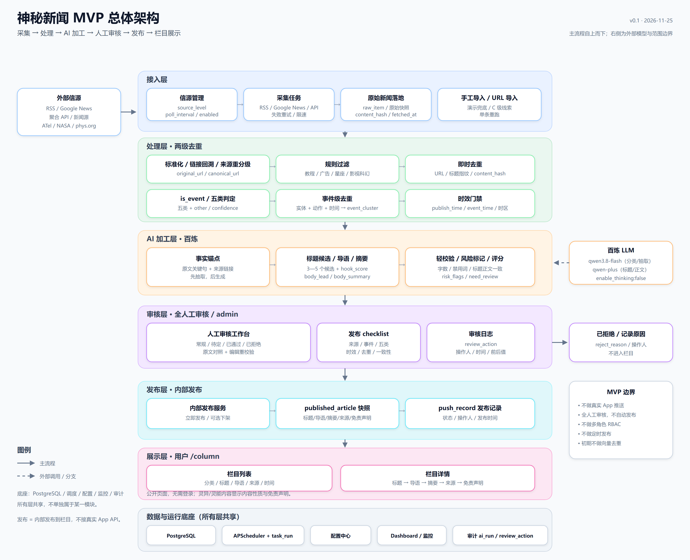
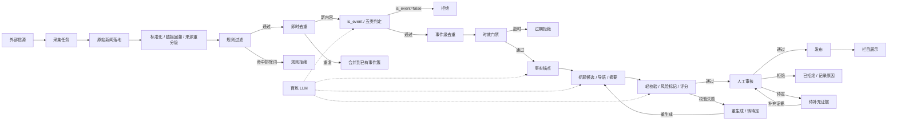
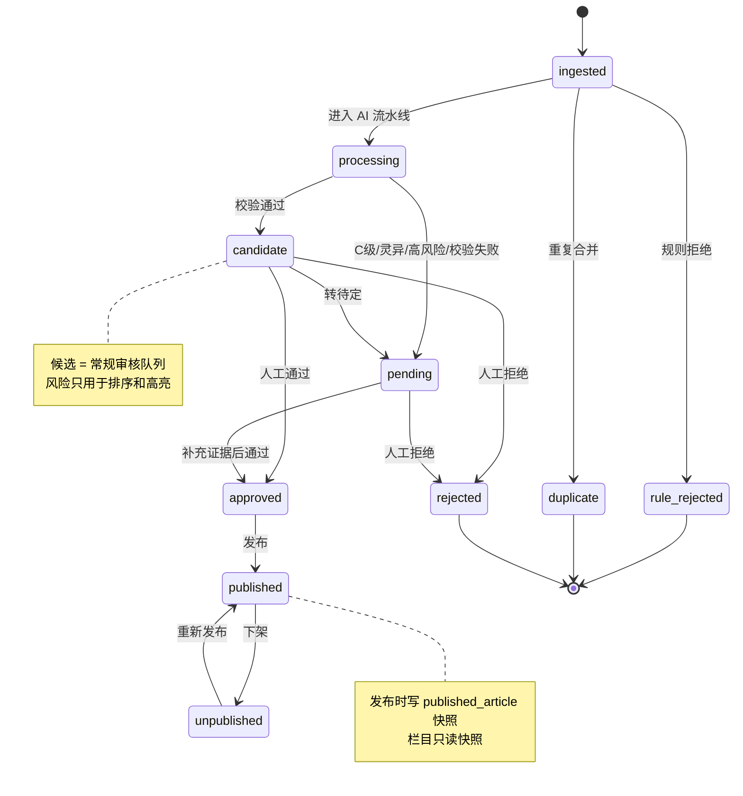
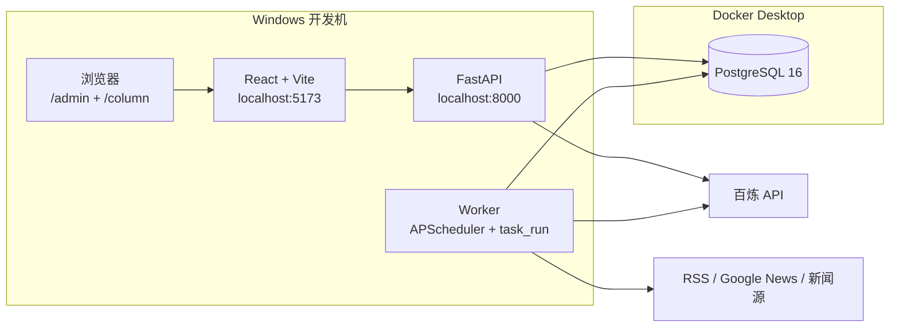

# 神秘新闻 MVP 总体架构

> 版本：v0.1  
> 日期：2026-11-25  
> 范围：采集 → 处理 → AI 加工 → 人工审核 → 发布 → 栏目展示  
> 非目标：真实 App 推送、自动发布、多角色 RBAC、定时发布、初期向量语义去重  
> 配套：[技术栈.md](./技术栈.md)（前后端、数据库、AI、基础设施选型）

---

## 0. 文档目的

本文只定**总体架构、模块边界和主链路**，不展开每个模块的字段、算法、prompt 和接口细节。

后续每个模块单独出一份分析文档，顺序见第 9 节。模块文档如果和本文冲突，以更新后的本文为准。

---

## 1. 总体架构图

> 矢量版：[01-总体架构.svg](./01-总体架构.svg)；位图版：`01-总体架构.png`（3200×2600，适合直接插入文档或视频）。

读图顺序：

- 左侧是外部信源；右侧是百炼 LLM 和 MVP 边界。
- 主流程自上而下：接入 → 处理 → AI → 审核 → 发布 → 展示。
- 底部是 PostgreSQL、调度、配置、监控、审计，所有层共享。
- 这里的“发布”是**内部发布到栏目**，不接真实 App API。

---

## 2. 主数据流

关键点：

- 规则过滤、即时去重、`is_event`、事件级去重、时效门禁是五道闸门。
- 事实锚点先于标题生成，避免“先写标题再补事实”。
- 人工审核是唯一发布前置条件；风险分数只用于排序和高亮，不触发自动发布。
- 发布写快照，栏目读快照，避免审核后原文被改导致展示不一致。

---

## 3. 状态机

| 状态 | 含义 | 可执行动作 |
|---|---|---|
| `ingested` | 原始新闻已落地 | 进入处理流水线 |
| `rule_rejected` | 规则命中排除词 | 归档，记录原因 |
| `duplicate` | 判定为重复事件 | 合并到已有事件簇 |
| `processing` | 正在做事件判定 / AI 加工 | 等待任务完成 |
| `candidate` | 通过基础校验，进入常规审核 | 通过 / 拒绝 / 转待定 |
| `pending` | 证据不足、C 级源、灵异边界、高风险 | 补充证据后通过 / 拒绝 |
| `approved` | 审核通过，待发布 | 发布 |
| `rejected` | 人工拒绝 | 归档，记录 `reject_reason` |
| `published` | 已发布到栏目 | 下架 |
| `unpublished` | 已下架 | 重新发布 |

说明：

- `candidate` 和 `pending` 不是两张独立表，而是审核队列视图；底层用 `status` + `review_priority`。
- MVP 里 `need_review` 固定为 true。
- `published` 之后修改内容，必须重新审核、重新发布，不能直接改已发布快照。

---

## 4. 部署与运行

运行约定：

- Windows 本地开发；Docker 只跑依赖，主方案是 PostgreSQL。
- 后端、Worker、前端本地跑；`start.ps1` 负责启动依赖、健康检查、迁移、seed、启动服务。
- 这里的“可部署”指：换一台 Windows 机器，按 README 和脚本能起来，不是上云。
- Redis 仅在后续切换 Celery 时引入；MVP 不装 Redis。
- 如果 Docker 不可用，SQLite 只作应急方案，不作为主方案。

---

## 5. 分层职责

| 层 | 模块 | 负责 | 不负责 |
|---|---|---|---|
| 接入层 | 信源管理 | 源配置、等级、轮询频率、启停 | 内容判定 |
| 接入层 | 采集任务 | RSS / Google News / 聚合 API 拉取、重试、限速 | 正文加工 |
| 接入层 | 原始新闻落地 | 原始标题、摘要、URL、HTML 快照、抓取时间 | 清洗和改写 |
| 接入层 | 手工导入 | URL 导入、单条重跑、演示兜底、C 级线索 | 批量采集 |
| 处理层 | 标准化 / 链接回溯 / 来源重分级 | 统一字段、解析 Google News 跳转、识别发布媒体、文章级重分级 | 最终真实性判断 |
| 处理层 | 规则过滤 | 教程、广告、星座、影视科幻、普通美图等排除 | 语义级事件判断 |
| 处理层 | 即时去重 | URL、标题指纹、`content_hash` | 跨来源事件合并 |
| 处理层 | `is_event` / 五类判定 | 判断是否具体事件、归入五类、抽取实体 | 事实真实性证明 |
| 处理层 | 事件级去重 | 实体 + 动作 + 时间 → `event_cluster` | 内容生成 |
| 处理层 | 时效门禁 | `publish_time` / `event_time` / 时区 / 未来事件规则 | 发布 |
| AI 层 | 事实锚点 | 从原文抽取关键事实句、来源链接 | 编造背景 |
| AI 层 | 标题 / 导语 / 摘要 | 3—5 个标题候选、`body_lead`、`body_summary` | 最终审核 |
| AI 层 | 轻校验 / 风险标记 / 评分 | 字数、禁用词、标题正文一致、`risk_flags`、`hook_score` | 替代人工 |
| 审核层 | 人工审核工作台 | 常规 / 待定 / 已通过 / 已拒绝；原文对照；编辑重校验 | 自动发布 |
| 审核层 | 发布 checklist | 来源、事件、五类、时效、去重、一致性 | 内容生成 |
| 审核层 | 审核日志 | `review_action`、操作人、时间、前后值 | 发布 |
| 发布层 | 内部发布服务 | 立即发布、可选下架 | 真实 App 推送 |
| 发布层 | `published_article` 快照 | 标题、导语、摘要、来源、内容性质、免责声明 | 读取实时文章 |
| 发布层 | `push_record` 发布记录 | 状态、操作人、发布时间 | 外部推送回执 |
| 展示层 | 栏目列表 / 详情 | 分类、标题、导语、摘要、来源、时间、免责声明 | 管理操作 |
| 底座 | PostgreSQL | 业务数据、快照、审计 | 业务逻辑 |
| 底座 | APScheduler + `task_run` | 定时采集、任务状态、重试、人工重跑 | 业务判定 |
| 底座 | 配置中心 | 信源、关键词、风险规则、Prompt 版本 | 内容生成 |
| 底座 | Dashboard / 监控 | 采集量、来源健康、待审核、失败率 | 业务审核 |
| 底座 | 审计 | `ai_run`、`review_action`、`task_run` | 内容展示 |

---

## 6. 核心数据实体

| 实体 | 作用 | 关键字段 |
|---|---|---|
| `source` | 信源配置 | `name`、`type`、`level`、`poll_interval`、`enabled`、`last_crawl_at` |
| `raw_item` | 原始抓取 | `source_id`、`url`、`raw_title`、`raw_summary`、`raw_html`、`fetched_at`、`content_hash` |
| `article` | 标准化与加工结果 | `raw_item_id`、`title`、`summary`、`publisher`、`original_url`、`canonical_url`、`source_level`、`event_type`、`is_event`、`event_time`、`status`、`risk_flags`、`content_nature` |
| `event_cluster` | 事件簇 | `event_type`、`entity`、`action`、`event_date`、`canonical_title`、`first_seen_at`、`published_at` |
| `ai_run` | AI 调用记录 | `article_id`、`stage`、`model`、`prompt_version`、`input_hash`、`output_json`、`tokens`、`latency`、`status` |
| `review_action` | 审核日志 | `article_id`、`reviewer`、`action`、`before_json`、`after_json`、`note`、`created_at` |
| `published_article` | 发布快照 | `article_id`、`title`、`body_lead`、`body_summary`、`source_name`、`source_url`、`source_level`、`content_nature`、`disclaimer`、`published_at`、`operator` |
| `push_record` | 发布记录 | `published_article_id`、`channel`、`payload_json`、`status`、`response`、`created_at` |
| `task_run` | 任务运行 | `task_type`、`source_id`、`status`、`started_at`、`finished_at`、`stats_json`、`error` |
| `keyword_rule` | 关键词规则 | `type`、`category`、`pattern`、`weight`、`enabled` |

字段细节留给《02-数据模型与状态机》。

---

## 7. 关键设计决策

1. **全人工审核**：所有内容都必须人工通过；`risk_flags` 和 `hook_score` 只用于排序、高亮和审核提示，不触发自动发布。
2. **来源等级是文章级**：Google News 的 B 级命中可能指向 A 级媒体，也可能指向 C 级自媒体；必须回溯原始 URL 后重新定级。
3. **两级去重**：即时去重（URL / 标题指纹 / `content_hash`）+ 事件级去重（实体 + 动作 + 时间 → `event_cluster`）。
4. **事实锚点前置**：先从原文抽事实锚点，再生成标题和正文；最后做标题正文一致性校验。
5. **发布快照**：发布时写 `published_article`，栏目只读快照；发布后修改必须重新审核、重新发布。
6. **任务队列**：APScheduler + `task_run` 表，不引入 Celery/Redis；Worker 单独进程，支持重试和人工重跑。
7. **百炼模型分工**：`qwen3.8-flash`（`enable_thinking:false`）做分类/抽取/翻译初稿；`qwen-plus` 做标题/正文；难题再上 `qwen3.8-max`。
8. **五类内容**：深空/粒子、近地天体、新星球/类地行星、脑机/意识、异常/灵能；异常/灵能必须带 `content_nature` 和免责声明。
9. **演示双轨**：真实采集 + 预置样例；网络或 LLM 失败时回放缓存，保证演示视频稳定。
10. **发布是内部发布**：不接真实 App API、不做外部消息推送；栏目页是同一个 React 应用里的公开页面。

---

## 8. MVP 范围与非目标

### 8.1 范围内

- 信源管理、RSS/Google News/聚合 API 采集、手工导入、原始快照。
- 标准化、链接回溯、来源重分级、规则过滤、`is_event`/五类、两级去重、时效门禁。
- 事实锚点、标题候选、导语、摘要、轻校验、风险标记、评分。
- 人工审核工作台、原文对照、编辑重校验、审核日志、发布 checklist。
- 内部发布、发布快照、发布记录、可选下架。
- 栏目列表和详情（移动端窄屏风格）。
- Dashboard、任务运行状态、来源健康、失败重试。
- 演示数据、演示脚本、README、Docker 依赖、一键启动脚本。

### 8.2 非目标

| 非目标 | 说明 |
|---|---|
| 真实 App 推送 | 不接 App 后端 API，不做消息通知 |
| 自动发布 | 所有内容必须人工通过 |
| 多角色 RBAC | MVP 单管理员登录即可 |
| 定时发布 | MVP 只做立即发布；定时发布后置 |
| 向量语义去重 | 初期用标题指纹 + 实体/事件匹配；不够再引入 embedding |
| 微服务 / K8s / Kafka / ES | 单服务 + PostgreSQL + Worker 足够 |
| 小程序 / 独立 App | 栏目页放在同一个 React 应用里 |

### 8.3 交付物

- 代码仓库：后端、前端、Docker Compose、脚本、演示数据、分析文档、README。
- 演示视频：5—8 分钟，覆盖采集、处理、审核、发布、栏目展示。
- 演示数据：10—15 条覆盖验收用例的样例，支持实时采集 + 回放双轨。

---

## 9. 后续分析文档

| 顺序 | 文档 | 必须先定下来 |
|---|---|---|
| 0 | 范围与验收 | 演示脚本、非目标、10 条验收用例 |
| 1 | 总体架构与范围（本文） | 结构图、模块边界、发布/栏目层 |
| 2 | 数据模型与状态机 | 表、状态流转、发布快照、审计、唯一约束 |
| 3 | 信源管理 | 源清单、`source` 模型、分级、域名规则、健康状态、seed |
| 4 | 采集 | 适配器、关键词与 query 设计、调度、抓取规范、链接回溯、落地、质量验证 |
| 5 | 预处理与事件判定 | 排除词规则、`is_event`、五类归类 |
| 6 | 去重与时效 | 指纹、事件簇、时间语义 |
| 7 | AI 加工 | 百炼 prompt、Schema、事实锚点、校验、风险、成本 |
| 8 | 审核工作台 | 队列、原文对照、编辑重校验、审核日志、发布 checklist |
| 9 | 发布与栏目展示 | 发布快照、下架、栏目列表/详情、免责声明 |
| 10 | 演示脚本与验收 | 演示数据、视频分镜、指标、失败回放 |
| 11 | 部署与运行 | Windows/Docker、配置、日志、备份 |

---

## 10. 未决问题

这些问题留给对应模块文档，不在本文拍死：

| 问题 | 留给 |
|---|---|
| 时效以 `publish_time` 还是 `event_time` 为准；24—48 小时怎么定义；未来事件怎么处理 | 05-去重与时效 |
| 正文是否只要 `body_lead` + `body_summary`，还是需要完整文章 | 06-AI 加工 / 08-发布与栏目展示 |
| 标题 10—18 字与示例 8—9 字的冲突；字数是否含标点 | 06-AI 加工 |
| C 级源/灵异内容的确认标准；是否需要双人复核 | 07-审核工作台 |
| 是否需要封面图/配图；图片版权怎么处理 | 08-发布与栏目展示 |
| 是否需要定时发布、下架、重新发布 | 08-发布与栏目展示 |
| 演示视频时长、旁白/字幕、录屏分辨率 | 09-演示脚本与验收 |

---

## 11. 变更记录

| 版本 | 日期 | 变更 |
|---|---|---|
| v0.1 | 2026-11-25 | 初版；加入发布层和栏目展示；确定 APScheduler + `task_run`；确定百炼模型分工 |
